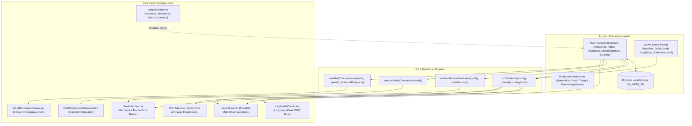

# Retirement Financial Planner — Architecture & System Wiki

Comprehensive technical, mathematical, and functional documentation for the **Retirement Financial Planner** web application.

---

## Table of Contents

- [1. Project Overview](#1-project-overview)
  - [1.1 Purpose & Problem Statement](#11-purpose--problem-statement)
  - [1.2 Evolution from Spreadsheet to Web Application](#12-evolution-from-spreadsheet-to-web-application)
- [2. System Architecture & Tech Stack](#2-system-architecture--tech-stack)
  - [2.1 Technology Stack](#21-technology-stack)
  - [2.2 Directory & Codebase Structure](#22-directory--codebase-structure)
  - [2.3 High-Level Component & Data Flow](#23-high-level-component--data-flow)
- [3. User Inputs & Configuration Model](#3-user-inputs--configuration-model)
  - [3.1 Scenario Parameters (Single & 2-Person Households)](#31-scenario-parameters-single--2-person-households)
  - [3.2 Milestone Ages & Phase Triggers](#32-milestone-ages--phase-triggers)
  - [3.3 Economic, Inflation & Tax Rates](#33-economic-inflation--tax-rates)
  - [3.4 Monthly Living & Decoupled Medical Expenses](#34-monthly-living--decoupled-medical-expenses)
  - [3.5 Annual Major Expenses Scheduler (Up to 10 Milestone Entries)](#35-annual-major-expenses-scheduler-up-to-10-milestone-entries)
  - [3.6 Income & Asset Sources (Up to 20 Accounts)](#36-income--asset-sources-up-to-20-accounts)
- [4. Calculation Engine & Mathematical Logic](#4-calculation-engine--mathematical-logic)
  - [4.1 Retirement Phase Segmentation & Proration](#41-retirement-phase-segmentation--proration)
  - [4.2 Expense Inflation & Major Milestone Integration](#42-expense-inflation--major-milestone-integration)
  - [4.3 Gross-Up Withdrawal & Tax Projections](#43-gross-up-withdrawal--tax-projections)
  - [4.4 Account-Level Liquidation Cascade & Rule of 55 / IRA Rules](#44-account-level-liquidation-cascade--rule-of-55--ira-rules)
  - [4.5 Multi-Member Synchronized Pre-Tax Drawdown (RMD Mitigation)](#45-multi-member-synchronized-pre-tax-drawdown-rmd-mitigation)
  - [4.6 IRS Uniform Lifetime Table RMD Mandates & Reinvestment](#46-irs-uniform-lifetime-table-rmd-mandates--reinvestment)
  - [4.7 Systematic Roth Conversion Optimization Engine](#47-systematic-roth-conversion-optimization-engine)
  - [4.8 Monte Carlo Probabilistic Simulation Engine](#48-monte-carlo-probabilistic-simulation-engine)
  - [4.9 Historical Stress-Testing Presets](#49-historical-stress-testing-presets)
  - [4.10 End-of-Year Balances & Depletion Detection](#410-end-of-year-balances--depletion-detection)
- [5. User Interface & Feature Modules](#5-user-interface--feature-modules)
  - [5.1 Dashboard & Key Results KPI Cards](#51-dashboard--key-results-kpi-cards)
  - [5.2 Interactive Recharts Layer & Monte Carlo Percentiles](#52-interactive-recharts-layer--monte-carlo-percentiles)
  - [5.3 Detailed Year-by-Year Simulation Table & Drawer Breakdowns](#53-detailed-year-by-year-simulation-table--drawer-breakdowns)
  - [5.4 Systematic Roth Conversion Strategy Simulator](#54-systematic-roth-conversion-strategy-simulator)
  - [5.5 What-If Strategy Comparison Engine](#55-what-if-strategy-comparison-engine)
  - [5.6 Inputs & Source Manager](#56-inputs--source-manager)
  - [5.7 In-Browser Excel (.xlsx) Exporter](#57-in-browser-excel-xlsx-exporter)
  - [5.8 Standalone Deployment Build (/standalone)](#58-standalone-deployment-build-standalone)
- [6. Development & Operational Commands](#6-development--operational-commands)

---

## 1. Project Overview

### 1.1 Purpose & Problem Statement
The **Retirement Financial Planner** is an institutional-grade, multi-decade financial projection and simulation platform designed to answer key retirement planning questions:
> *"Given our household investment accounts, milestone ages, scheduled life events, and spending requirements, how long will our portfolio last, and what is the optimal withdrawal and conversion sequence to minimize lifetime taxes while guaranteeing lifestyle cash flows?"*

The system projects year-by-year cash flows across up to 40 projection years (ages 50–100+), accounting for:
1. **Asset Depletion vs. Guaranteed Streams**: Differentiating between depletable investment assets (401ks, IRAs, taxable brokerage, savings) and guaranteed lifetime income (Social Security, pensions, annuities).
2. **Two-Person Household Coordination**: Synchronizing milestone ages, dual retirement dates, individual Social Security start dates, and account ownership for both Primary and Spouse.
3. **Decoupled Expense Tracks & Major One-Time Purchases**: Modeling general living expenses, pre-/post-Medicare healthcare inflation, and up to 10 scheduled major annual expenses (vehicles, remodeling, weddings, long-term care).
4. **Tax-Aware Withdrawal Gross-Ups**: Calculating required gross withdrawals to ensure that net after-tax proceeds satisfy all spending needs under current federal, state, and capital gains rules.
5. **Multi-Member Pre-Tax Drawdown Strategy**: Synchronizing 401(k) / IRA drawdowns between spouses to prevent late-life RMD tax bracket explosions.
6. **Systematic Roth Conversions**: Modeling pre-73 conversions to fill lower marginal tax brackets and eliminate future RMD spikes.
7. **Monte Carlo Probabilistic Analysis**: Simulating 200+ randomized market paths to compute probability of success and 10th-to-90th percentile wealth bands.
8. **What-If Optimization Comparisons**: Evaluating side-by-side trade-offs between Tax Minimization, RMD Reduction, Spending Maximization, and Estate Legacy.

### 1.2 Evolution from Spreadsheet to Web Application
The application was originally conceptualized as an Excel calculation workbook. To make the planner accessible, interactive, and mobile-friendly without requiring spreadsheet software, the mathematical logic was engineered into a client-side TypeScript calculation engine, with interactive data visualizers and an in-browser Excel export utility that compiles the multi-sheet workbook on demand.

---

## 2. System Architecture & Tech Stack

### 2.1 Technology Stack
- **Runtime**: Node.js 22.
- **Frontend Framework**: React 18+ with TypeScript (strict type checking enabled).
- **Build Tool & Bundler**: Vite 6.
- **Styling**: Tailwind CSS v4 using modern `@import "tailwindcss";` directives.
- **Iconography**: Lucide React.
- **Data Visualization**: Recharts (reactive SVG line, area, and stacked bar charts).
- **Excel Generation**: SheetJS (`xlsx`) for client-side multi-sheet `.xlsx` file compilation.
- **Persistence**: Browser `localStorage` for automatic scenario and draft preservation.
- **Standalone Distribution**: Automated compilation into `/standalone` for static container or web server hosting.

### 2.2 Directory & Codebase Structure

```
/
├── index.html                   # HTML entry point with metadata tags
├── metadata.json                # AI Studio application manifest & permissions
├── package.json                 # Scripts (dev, build, lint) and dependencies
├── tsconfig.json                # TypeScript compilation configuration
├── vite.config.ts               # Vite configuration (port 3000, 0.0.0.0 host)
├── WIKI.md                      # System documentation & wiki
├── standalone/                  # Compiled production distribution for standalone deployment
│   ├── index.html
│   ├── manifest.json
│   └── assets/
└── src/
    ├── main.tsx                 # React application mounting point
    ├── index.css                # Tailwind CSS global styles
    ├── App.tsx                  # Root application component & state orchestrator
    ├── types.ts                 # Central TypeScript interfaces & type definitions
    ├── defaultData.ts           # Baseline scenario parameters, stress presets & sample accounts
    ├── engine.ts                # Deterministic & Monte Carlo retirement simulation engine (optimized)
    ├── whatifEngine.ts          # Optimization & comparative scenario engine
    ├── exportExcel.ts           # In-browser Excel (.xlsx) workbook generator
    ├── utils/
    │   └── formatters.ts        # Centralized currency, compact, percent & age formatters
    └── components/
        ├── Header.tsx           # Top navigation, scenario metadata & global actions
        ├── KeyResultsCards.tsx  # KPI summary metrics (Depletion, Longevity, Balance, Taxes)
        ├── ChartsSection.tsx    # Responsive charts (Depletion, Monte Carlo, Income, Expenses, Balances)
        ├── PlanTable.tsx        # Full year-by-year table with expandable drawer breakdowns
        ├── InputsSection.tsx    # Parameter manager orchestrator (delegates to modular sub-tabs)
        ├── inputs/              # Modular input tab components:
        │   ├── SourcesTab.tsx   # Income & 20-source account prioritization table
        │   ├── ScenarioTab.tsx  # 2-person household, birth dates, salaries & milestones
        │   ├── RatesTab.tsx     # Returns, inflation, decoupled healthcare & tax rates
        │   ├── ExpensesTab.tsx  # Living & pre-/post-Medicare medical expenses
        │   └── MajorExpensesTab.tsx # 10-milestone major one-time expense scheduler
        ├── RothConversionSimulator.tsx # Dedicated systematic Roth conversion visualizer & optimizer
        ├── WhatIfComparisonView.tsx    # 4-strategy side-by-side scenario comparison cards & deltas
        └── PhaseExplanationCard.tsx    # Visual guide to household milestone phases
```

### 2.3 High-Level Component & Data Flow



---

## 3. User Inputs & Configuration Model

All parameters are strictly typed within `PlannerConfig` (`src/types.ts`).

### 3.1 Scenario Parameters (Single & 2-Person Households)
| Field | Type | Default | Description |
| :--- | :--- | :--- | :--- |
| `userName` | `string` | `"John Doe"` | Primary plan owner's name. |
| `birthDate` | `string` (`YYYY-MM-DD`) | `"1970-06-15"` | Reference birth date for computing exact age each projection year. |
| `retSalary` | `number` | `$150,000` | Full-year salary in the retirement year, prorated during Phase 0. |
| `retDate` | `string` (`YYYY-MM-DD`) | `"2030-07-01"` | Target retirement date for the primary member. |
| `ssStartDate` | `string` (`YYYY-MM-DD`) | `"2037-06-15"` | Social Security benefit commencement date. |
| `pensionStartDate` | `string` (`YYYY-MM-DD`) | `"2032-06-15"` | Pension / annuity commencement date. |
| `lifeExpAge` | `number` | `90` | Planning horizon target age for fund depletion evaluation. |
| `taxablePct` | `number` | `0.70` (70%) | Share of general withdrawals originating from taxable accounts. |
| `hasSpouse` | `boolean` | `true` | Enables dual-member retirement coordination. |
| `spouseName` | `string` | `"Jane Doe"` | Spouse / partner name. |
| `spouseBirthDate` | `string` (`YYYY-MM-DD`) | `"1972-09-20"` | Spouse birth date. |
| `spouseRetSalary` | `number` | `$95,000` | Spouse pre-retirement salary. |
| `spouseRetDate` | `string` (`YYYY-MM-DD`) | `"2034-01-01"` | Target retirement date for spouse. |
| `spouseLifeExpAge` | `number` | `92` | Spouse planning horizon age. |
| `spouseSsStartDate`| `string` (`YYYY-MM-DD`) | `"2039-09-20"` | Spouse Social Security commencement date. |

### 3.2 Milestone Ages & Phase Triggers
- `four01kAge` / `spouseFour01kAge` (Default: `55`): Rule of 55 penalty-free 401(k) / 403(b) retirement access.
- `iraAge` / `spouseIraAge` (Default: `60`): Traditional & Roth IRA penalty-free access (age 59½ / 60).
- `ssMinAge` / `spouseSsMinAge` (Default: `62`): Earliest Social Security eligibility.
- `medicareAge` (Default: `65`): Transition to Medicare coverage & post-Medicare expense schedules.
- `rmdAge` (Default: `73`): SECURE 2.0 Act mandatory minimum distribution commencement age.

### 3.3 Economic, Inflation & Tax Rates
- `investRate` (Default: `6.0%`): Nominal annual compound growth on portfolio balances.
- `inflationRate` (Default: `2.5%`): Annual inflation for living expenses and inflation-adjusted major purchases.
- `medicalInflationRate` (Default: `4.5%`): Independent higher inflation rate for healthcare premiums and OOP costs.
- `fedBracket` (Default: `22.0%`): Target marginal federal income tax bracket.
- `stateRate` (Default: `5.0%`): State income tax rate.
- `capgainRate` (Default: `15.0%`): Long-term capital gains tax rate.
- `capgainPct` (Default: `0.0%`): Percentage of taxable withdrawals characterized as capital gains.

### 3.4 Monthly Living & Decoupled Medical Expenses
- `expDaily` (Default: `$5,000/mo`): General living, housing, food, and discretionary expenses.
- `expMedPremium` (Default: `$600/mo`): Pre-Medicare private / ACA health insurance premiums.
- `expMedOop` (Default: `$300/mo`): Pre-Medicare out-of-pocket medical, dental, and prescription expenses.
- `expMedPremiumPost` (Default: `$320/mo`): Post-Medicare Part B, Part D, and Medigap supplement premiums.
- `expMedOopPost` (Default: `$180/mo`): Post-Medicare out-of-pocket medical expenses.

### 3.5 Annual Major Expenses Scheduler (Up to 10 Milestone Entries)
Users can schedule up to 10 major one-time annual expenses by age:
- `id`: Unique identifier.
- `name`: Description (e.g., *"Home Renovation / Roof"*, *"New Vehicle"*, *"Family Milestone Gift"*, *"Long-Term Care Buffer"*).
- `age`: Target primary milestone age.
- `amount`: Dollar expense.
- `inflationAdjusted`: When `true`, compounds from base year with general inflation; when `false`, treated as fixed nominal dollars.
- `notes`: Optional memo on financing or purpose.

### 3.6 Income & Asset Sources (Up to 20 Accounts)
Each account or guaranteed income stream within `sources[]`:
- `name`: Account label.
- `owner`: `'primary' | 'spouse' | 'joint'`.
- `accountType`: `'401k' | 'ira' | 'roth' | 'brokerage' | 'cash' | 'other'`.
- `balance`: Starting balance (for depleting accounts).
- `priority`: Liquidation priority integer (1 = first to liquidate, 2, 3... 99 = last).
- `monthly`: `'N'` for depleting asset pools; `'Y'` for guaranteed recurring streams.
- `taxType`: `'Income'` (ordinary income tax), `'Capital Gain'` (capital gains rate), or `'N/a'` (tax-free).
- `annualPayment`: Annual payout amount (when `monthly === 'Y'`).
- `startAge`: Age threshold unlocking withdrawals or payments.

---

## 4. Calculation Engine & Mathematical Logic

The engine (`src/engine.ts`) executes a multi-asset simulation loop across the projection horizon.

### 4.1 Retirement Phase Segmentation & Proration
For each simulation year $i \in [0, N-1]$:
$$\text{Calendar Year} = \text{retYear} + i$$
$$\text{Primary Age}_i = \text{retAge} + i$$
$$\text{Spouse Age}_i = \text{spouseRetAge} + i$$

In the retirement transition year ($i = 0$, Phase 0):
$$\text{Work Fraction} = \frac{\text{retDate} - \text{Jan 1 of retYear}}{365}$$
$$\text{Primary Salary}_i = \text{retSalary} \times \text{Work Fraction}$$

If a spouse is working, their salary is computed based on their individual retirement date:
$$\text{Spouse Salary}_i = \begin{cases}
\text{spouseRetSalary}, & \text{Calendar Year} < \text{spouseRetYear} \\
\text{spouseRetSalary} \times \text{Spouse Work Fraction}, & \text{Calendar Year} = \text{spouseRetYear} \\
0, & \text{Calendar Year} > \text{spouseRetYear}
\end{cases}$$

### 4.2 Expense Inflation & Major Milestone Integration
1. **General Living Outflows**:
   $$\text{General Expenses}_i = 12 \times \text{expDaily} \times (1 + \text{inflationRate})^i$$

2. **Decoupled Healthcare Outflows**:
   $$\text{Base Med} = \begin{cases} 
   \text{expMedPremium} + \text{expMedOop}, & \text{Age}_i < \text{medicareAge} \\
   \text{expMedPremiumPost} + \text{expMedOopPost}, & \text{Age}_i \ge \text{medicareAge}
   \end{cases}$$
   $$\text{Medical Expenses}_i = 12 \times \text{Base Med} \times (1 + \text{medicalInflationRate})^i$$

3. **Scheduled Major Expenses**:
   For all configured major expenses matching $\text{Age}_i$:
   $$\text{Major Expenses}_i = \sum_{m \in \text{matching}} \begin{cases}
   m.\text{amount} \times (1 + \text{inflationRate})^i, & m.\text{inflationAdjusted} = \text{true} \\
   m.\text{amount}, & m.\text{inflationAdjusted} = \text{false}
   \end{cases}$$

4. **Total Required Annual Outflows**:
   $$\text{Total Expenses}_i = \text{General Expenses}_i + \text{Medical Expenses}_i + \text{Major Expenses}_i$$

### 4.3 Gross-Up Withdrawal & Account-Specific Tax Engine
To ensure after-tax liquidation satisfies total living and major expenses:
$$\text{Combined Income Tax Rate } (r_{\text{inc}}) = \text{fedBracket} + \text{stateRate}$$
$$r_{\text{tax}} = \text{taxablePct} \times \left[(1 - \text{capgainPct}) \times r_{\text{inc}} + \text{capgainPct} \times \text{capgainRate}\right]$$
$$\text{Gross Withdrawal Needed } (W_i) = \max\left(0, \frac{\text{Total Expenses}_i - (\text{Guaranteed Income}_i + \text{Salaries}_i) + r_{\text{inc}} \times \text{Taxable Income}_i}{1 - r_{\text{tax}}}\right)$$

Taxes are partitioned using account-specific statutory tax characterization:
1. **Pre-Tax Withdrawals** (`taxType === 'Income'`, e.g., Traditional 401(k), Traditional IRA): 100% ordinary taxable income.
2. **Taxable Brokerage Withdrawals** (`taxType === 'Capital Gain'`): Capital gains portion is taxed at $\text{capgainRate}$.
3. **Tax-Free Withdrawals** (`taxType === 'N/a'`, e.g., Roth accounts, Cash/Savings): 0% tax ($0 tax liability).
4. **Roth Conversions**: Transferred amounts are taxed once at the conversion target rate without living withdrawal double-taxation.

$$\text{Taxable Ordinary Income}_i = \text{Salary}_i + \text{GuarTaxable}_i + \text{OrdinaryLivingWd}_i$$
$$\text{Fed Tax}_i = \left(\text{fedBracket} \times \text{Taxable Ordinary Income}_i\right) + \text{RothConversionTax}_i$$
$$\text{State Tax}_i = \text{stateRate} \times \text{Taxable Ordinary Income}_i$$
$$\text{CapGain Tax}_i = \text{capgainRate} \times \left(\text{CapGainLivingWd}_i \times \text{capgainPct}\right)$$
$$\text{Total Tax}_i = \text{Fed Tax}_i + \text{State Tax}_i + \text{CapGain Tax}_i$$

### 4.4 Account-Level Liquidation Cascade & Rule of 55 / IRA Rules
Accounts become eligible for penalty-free liquidation based on ownership and account type:
- **401(k) / 403(b)**: Accessible at the owner's Rule of 55 milestone age.
- **Traditional & Roth IRAs**: Accessible at the owner's age 59½ / 60 milestone.
- **Taxable Brokerage & Cash**: Accessible without statutory age restrictions.

For standard accounts, the engine draws sequentially based on the user-assigned `priority` integer:
$$\text{Withdrawal}_{j,i} = \max\left(0, \min(W_i, \text{CumIncl}_j) - \min(W_i, \text{CumExcl}_j)\right)$$

### 4.5 Multi-Member Synchronized Pre-Tax Drawdown (RMD Mitigation)
To prevent one spouse's traditional 401(k) / IRA from compounding into high-bracket RMD distributions:
1. **Single-Eligible Window**: When only one spouse is of eligible age, their pre-tax accounts supply 100% of required pre-tax withdrawals.
2. **Dual-Eligible Transition**: In the year the second spouse reaches eligibility (e.g., turns 60), the engine unlocks their pre-tax accounts.
3. **Proportional Rebalancing**: Pre-tax withdrawals are divided based on relative pre-tax account balances:
   $$\text{Withdrawal}_{\text{primary}} = W_{\text{td}} \times \frac{\text{Balance}_{\text{primary\_td}}}{\text{Balance}_{\text{total\_td}}}$$
   $$\text{Withdrawal}_{\text{spouse}} = W_{\text{td}} \times \frac{\text{Balance}_{\text{spouse\_td}}}{\text{Balance}_{\text{total\_td}}}$$

### 4.6 IRS Uniform Lifetime Table RMD Mandates & Reinvestment
Starting at the configured input milestone age `milestones.rmdAge` (defaulting to IRS SECURE 2.0 age 73, or custom ages such as 70, 72, or 75), the engine calculates statutory RMDs for every pre-tax account using the IRS Uniform Lifetime Table (Publication 590-B, Table III):
$$\text{RMD}_{j,i} = \frac{\text{BeginBalance}_{j,i}}{\text{IRS Divisor}(\text{Age}_i)}$$

- If required living withdrawals exceed the statutory RMD, the distribution satisfies the mandate.
- If statutory RMD exceeds required withdrawals, the **RMD surplus** is grossed up for taxes and automatically reinvested into the household's primary taxable brokerage account.

### 4.7 Systematic Roth Conversion Optimization Engine
The engine models pre-RMD annual Roth conversions (up to the year preceding `rmdAge`):
$$\text{Bracket Room}_i = \max(0, \text{Bracket Max Income} - \text{Ordinary Taxable Income}_i)$$
$$\text{Converted Amount}_i = \min(\text{Bracket Room}_i, \text{Annual Cap}, \text{Pre-Tax Balance}_i)$$
$$\text{Conversion Tax}_i = \text{Converted Amount}_i \times (\text{Target Bracket Rate} + \text{State Rate})$$

- When `taxPaymentMethod === 'outsideBrokerage'`, taxes are paid from taxable brokerage funds, allowing the converted amount to transfer into Roth accounts to grow tax-free.

### 4.8 Monte Carlo Probabilistic Simulation Engine
The Monte Carlo engine (`runMonteCarloSimulation`) executes 200+ stochastic iterations using a Box-Muller normal distribution:
$$r_t \sim \mathcal{N}\left(\text{investRate}, \sigma^2\right)$$
- Tracks portfolio balance percentiles: **P10, P25, P50 (Median), P75, and P90**.
- Computes **Probability of Success**: Percentage of simulated trials where the portfolio remains funded through life expectancy.

### 4.9 Historical Stress-Testing Presets
Users can toggle between historical and economic stress environments:
1. **Baseline Plan**: User-configured expected market return & inflation rates.
2. **2008 Financial Crisis**: -37% Year 1, -10% Year 2, followed by economic rebound (+26%, +15%, +12%).
3. **1970s Stagflation**: 7.5% inflation for the first 5 years with low 2.0% equity returns.
4. **Early Bear Sequence**: Three consecutive negative return years (-12%, -15%, -8%) at retirement onset.
5. **Bull Market**: Sustained +10.0% annual returns with low 2.0% inflation.

### 4.10 End-of-Year Balances & Depletion Detection
Remaining balances compound at the investment rate:
$$\text{EndBalance}_{j,i} = \max\left(0, \text{BeginBalance}_{j,i} - \text{Withdrawals}_{j,i} + \text{Reinvestments}_{j,i}\right) \times (1 + r_i)$$
$$\text{Combined End Balance}_i = \sum_{j} \text{EndBalance}_{j,i}$$

If $\text{Combined End Balance}_i \le 0$ while $\text{Age}_i \le \text{lifeExpAge}$, the plan records the year of **DEPLETED** status.

---

## 5. User Interface & Feature Modules

### 5.1 Dashboard & Key Results KPI Cards
- **Longevity Status**: Displays "Funds Last Entire Plan" or the exact calendar year and age of fund depletion.
- **Starting Portfolio**: Initial combined balance across all accounts.
- **Peak RMD at Age 73+**: Displays maximum mandatory distribution, highlighting RMD tax exposure.
- **Estimated Lifetime Taxes**: Sum of projected federal, state, and capital gains taxes.
- **Valuation Toggle**: Instant switching between **Nominal ($)** and **Real (Today's Purchasing Power $)**.

### 5.2 Interactive Recharts Layer & Monte Carlo Percentiles
- **Overall Depletion View**: Area chart with optional milestone reference lines (Retirement, Medicare, RMD).
- **Monte Carlo Probabilistic Fan**: Shaded percentile bands (P10 to P90) with an interactive volatility slider (8% to 22%).
- **Income by Source**: Stacked columns illustrating portfolio withdrawals and guaranteed cash flows.
- **Expenses & Taxes Breakdown**: Stacked bars categorizing General Living, Healthcare, Major Milestone Expenses, and Taxes.
- **Balances by Account**: Multi-colored area breakdown showing individual account depletion trajectories.

### 5.3 Detailed Year-by-Year Simulation Table & Drawer Breakdowns
- Complete 40-year tabular projection matching institutional financial planning formats.
- Milestone badge indicators for each phase.
- Highlighted markers for scheduled Major Expenses.
- Expandable accordion drawers per row displaying per-account beginning balances, withdrawals, and end balances.

### 5.4 Systematic Roth Conversion Strategy Simulator
- Dedicated interface to model bracket-filling conversions between target ages (e.g., ages 60–72).
- Displays lifetime tax savings, peak RMD reduction, and net balance differences.
- Conversion schedule table detailing bracket room, converted amounts, and tax liabilities paid.

### 5.5 What-If Strategy Comparison Engine
Provides side-by-side comparative analysis of 4 distinct financial strategies against the baseline:
1. **Minimize Taxes**: Optimizes withdrawal ordering and pre-73 Roth conversions.
2. **Minimize Future RMD**: Reduces pre-tax balances prior to age 73.
3. **Maximize Sustainable Spending**: Identifies the maximum sustainable lifestyle expenditure multiplier without fund depletion.
4. **Maximize Estate Legacy**: Preserves Roth accounts to compound tax-free for beneficiaries.

### 5.6 Inputs & Source Manager
- Tabbed parameter manager for Scenario, Milestone Ages, Economic Rates, Monthly Living Expenses, and Major Expenses.
- Account manager supporting up to 20 custom sources with ownership assignment, asset classification, and priority sorting.

### 5.7 In-Browser Excel (.xlsx) Exporter
Generates a multi-sheet `.xlsx` workbook containing:
- `Inputs`: All household parameters, milestone ages, rates, and accounts.
- `Plan`: Full year-by-year cash flows, tax breakdowns, and balances.
- `ChartData`: Formatted data series for replicating visualizations in spreadsheet tools.

### 5.8 Standalone Deployment Build (/standalone)
The application includes automated production build targets that compile the application into a standalone static package (`/standalone`) containing `index.html`, minified JavaScript and CSS bundles, and `manifest.json` for web hosting.

---

## 6. Development & Operational Commands

All development tasks are managed via npm scripts:

```bash
# Start Vite development server (accessible at http://localhost:3000)
npm run dev

# Run TypeScript type verification
npm run lint

# Compile production build and synchronize /standalone directory
npm run build

# Preview production build locally
npm run preview
```
