# Retirement Financial Planner — Wiki

Generated documentation for the [angietong/retirementplanner](https://github.com/angietong/retirementplanner) project.

## Table of Contents

- [1 Project Overview](#section-1)
  - [1.1 Goals and Problem Statement](#section-1-1)
  - [1.2 Tech Stack and Constraints](#section-1-2)
- [2 User Inputs and Configuration](#section-2)
  - [2.1 Scenario Parameters and Milestone Ages](#section-2-1)
  - [2.2 Income Sources](#section-2-2)
  - [2.3 Expenses and Rates](#section-2-3)
- [3 Calculation Engine and Logic](#section-3)
  - [3.1 Phase System and Retirement Year Proration](#section-3-1)
  - [3.2 Compound Growth and Inflation Adjustment](#section-3-2)
  - [3.3 Priority-Based Withdrawal Sequencing](#section-3-3)
  - [3.4 Tax Projection Sub-system](#section-3-4)
- [4 Excel Workbook Architecture](#section-4)
  - [4.1 Workbook Structure and Worksheet Layout](#section-4-1)
  - [4.2 Calculation Pipeline and Formula Dependencies](#section-4-2)
  - [4.3 Charts and Visualization Layer](#section-4-3)
- [5 Outputs and Reading the Plan](#section-5)
  - [5.1 Overall Depletion Chart](#section-5-1)
  - [5.2 Annual Plan Stacked Bar Chart](#section-5-2)
- [6 Glossary](#section-6)
  - [6.1 Financial Terms](#section-6-1)
  - [6.2 Technical and Excel Terms](#section-6-2)

<a id="section-1"></a>

## 1 Project Overview

<details>
<summary>Relevant source files</summary>

The following files were used as context for generating this wiki page:

- [Readme.txt](Readme.txt)
- [Retirement Financial Planner.md](Retirement Financial Planner.md)

</details>

The **Retirement Financial Planner** is a specialized financial modeling tool built entirely within Microsoft Excel. It is designed to help individuals answer the critical question: *"How long will my retirement funds last?"* [Retirement Financial Planner.md:7-7](). 

The system processes a comprehensive set of user-defined parameters—including birth dates, milestone ages, income source balances, and projected rates—to simulate a year-by-year retirement timeline. It optimizes for tax efficiency by sequencing withdrawals based on user-defined priorities and target tax brackets [Retirement Financial Planner.md:4-4, 20-20]().

### Core Purpose and Goals
The primary objective of the planner is to provide a visual and data-driven roadmap for retirement, specifically focusing on:
*   **Sustainability Projection:** Identifying the exact year (if any) that total funding balances hit zero [Retirement Financial Planner.md:85-85]().
*   **Tax Minimization:** Determining the optimal withdrawal sequence to keep income tax below a specific target federal tax bracket [Retirement Financial Planner.md:20-20]().
*   **Phase-Based Planning:** Segmenting the retirement timeline into logical "Phases" (e.g., Early Retirement, Medicare Eligible, RMD Age) to adjust logic as constraints change [Retirement Financial Planner.md:21-23]().
*   **Inflation-Adjusted Reporting:** Presenting all future dollar figures in "today's dollars" to maintain purchasing power relevance [Retirement Financial Planner.md:86-86]().

For a detailed breakdown of the project objectives and the v1 feature checklist, see [Goals and Problem Statement](#section-1-1).

### System Architecture
The project follows a two-file architecture consisting of a functional specification and a realized implementation.

| Component | File Path | Role |
| :--- | :--- | :--- |
| **Functional Specification** | `Retirement Financial Planner.md` | Defines the logic, input types, tax rules, and calculation requirements. |
| **Excel Workbook** | `Retirement_Financial_Planner.xlsx` | The execution engine containing the UI (Form), calculation logic, and visualizations. |

#### Data Flow: From Specification to Code Entity
The following diagram illustrates how the natural language requirements in the specification map to the internal structure of the Excel workbook.

**Requirement to Implementation Mapping**
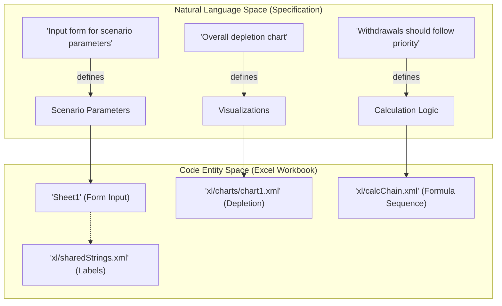
Sources: [Retirement Financial Planner.md:14-24](), [Retirement Financial Planner.md:97-100]()

### High-Level Logic Flow
The planner operates by iterating through years, beginning with a "Phase 0" (the retirement year) which handles prorated salary and expenses [Retirement Financial Planner.md:22-22, 78-78](). It then applies compound growth to account balances while subtracting inflation-adjusted expenses and projected taxes [Retirement Financial Planner.md:77-79]().

**Calculation Pipeline**
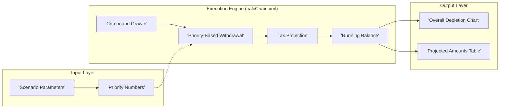
Sources: [Retirement Financial Planner.md:76-86](), [Retirement Financial Planner.md:89-95]()

### Constraints and Privacy
The system is strictly contained within Microsoft Excel to ensure data privacy. No external APIs, live market lookups, or third-party integrations are utilized; all data remains within the local spreadsheet [Retirement Financial Planner.md:99-103](). 

For details on the technology choices and privacy constraints, see [Tech Stack and Constraints](#section-1-2).

Sources:
- [Retirement Financial Planner.md:4-11]()
- [Retirement Financial Planner.md:14-24]()
- [Retirement Financial Planner.md:76-86]()
- [Retirement Financial Planner.md:97-103]()

<a id="section-1-1"></a>

### 1.1 Goals and Problem Statement

<details>
<summary>Relevant source files</summary>

The following files were used as context for generating this wiki page:

- [Retirement Financial Planner.md](Retirement Financial Planner.md)

</details>

The **Retirement Financial Planner** is a standalone Excel-based modeling tool designed to simulate a user's financial trajectory from their retirement date through the end of their life expectancy. The primary technical objective is to determine the sustainability of various income sources while optimizing for tax efficiency through priority-based withdrawal sequencing.

### Core Question and Objective

The planner is engineered to answer a specific multi-variable problem:
> "Given a set of initial balances, expected returns, and inflation rates, how long will retirement funds last, and what is the optimal sequence of withdrawals to minimize tax liability while remaining below a target federal tax bracket?"
> [Retirement Financial Planner.md:7-7]()

#### Primary Goals:
1.  **Sustainability Analysis**: Project the year-by-year balance of all assets to identify the "Fund Depletion" year [Retirement Financial Planner.md:85-85]().
2.  **Tax Minimization**: Utilize a priority-weighted algorithm to select withdrawal sources that keep taxable income within a user-defined "Target Federal Tax Bracket" [Retirement Financial Planner.md:20-20](), [Retirement Financial Planner.md:54-54]().
3.  **Phase-Based Modeling**: Segment the retirement timeline into distinct "Phases" triggered by milestone ages (e.g., RMD age, Medicare age) to account for shifting income and expense profiles [Retirement Financial Planner.md:21-23]().
4.  **Inflation Normalization**: Present all future projections in "today's dollars" to ensure the plan remains interpretable over multi-decade spans [Retirement Financial Planner.md:86-86]().

### System Logic Flow
The following diagram illustrates how natural language goals translate into the system's internal calculation pipeline.

**Figure 1: Goal-to-Logic Mapping**
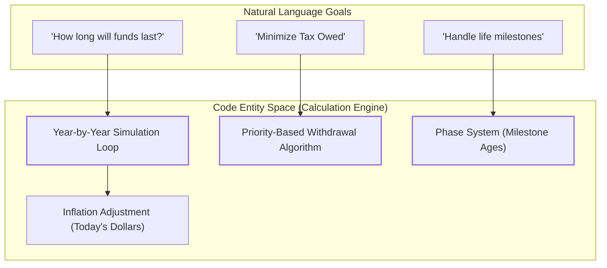
**Sources:** [Retirement Financial Planner.md:7-11](), [Retirement Financial Planner.md:76-86]()

### V1 Feature Checklist
The specification defines a set of core features that must be present in the workbook architecture:

| Feature Category | Implementation Requirement |
| :--- | :--- |
| **Scenario Inputs** | User Name, Birth Date, Retirement Year Salary, Target Retirement Date, and Taxable Income Percentage [Retirement Financial Planner.md:59-67](). |
| **Income Management** | Support for up to 20 income sources including 401k (Tax-deferred/Roth), IRA, Savings, Investment, Annuity, Social Security, Pension, and Restricted Stock [Retirement Financial Planner.md:15-15](), [Retirement Financial Planner.md:30-41](). |
| **Expense Tracking** | Monthly day-to-day expenses, medical premiums, and medical out-of-pocket costs, all subject to inflation [Retirement Financial Planner.md:44-48](). |
| **Phase Logic** | Automatic recalculation of plans based on Milestone Ages: 401k/IRA Penalty-free age, Medicare start, Social Security min age, and RMD age [Retirement Financial Planner.md:69-73](). |
| **Visualizations** | Overall Depletion Chart (Line/Area) and Annual Plan Stacked Bar Chart (Income vs. Expense) [Retirement Financial Planner.md:89-95](). |

### Data Flow and Withdrawal Logic
The planner uses a specific sequence to solve the withdrawal problem each year.

**Figure 2: Withdrawal Logic Data Flow**
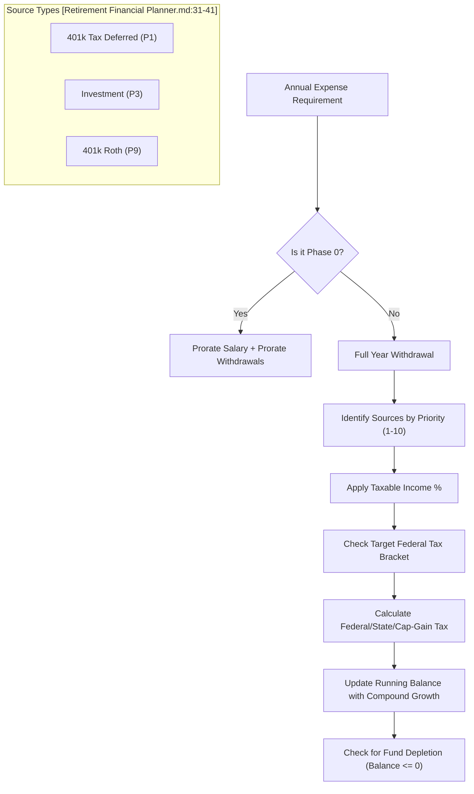
**Sources:** [Retirement Financial Planner.md:15-15](), [Retirement Financial Planner.md:31-41](), [Retirement Financial Planner.md:76-85]()

### Out of Scope and Future Iterations
To maintain the constraint of a standalone Excel platform [Retirement Financial Planner.md:98-100](), certain complexities are explicitly excluded from the current version.

#### Out of Scope (v1)
*   **Full Tax Engine**: The system uses a simplified pre/post-tax toggle and fixed state/federal rates rather than a complete IRS tax table simulation [Retirement Financial Planner.md:106-106]().
*   **Multi-Person Planning**: The logic is currently limited to a single user's milestones and accounts [Retirement Financial Planner.md:107-107]().
*   **Live Data**: No external APIs for real-time market data or Social Security lookups are integrated [Retirement Financial Planner.md:108-108]().

#### Open Questions for Future Versions
*   **Monte Carlo Simulation**: Adding stochastic modeling for investment returns [Retirement Financial Planner.md:25-25]().
*   **Roth Conversions**: Explicit logic for optimizing Roth conversion amounts as a withdrawal parameter [Retirement Financial Planner.md:113-113]().
*   **RMD Projections**: Detailed calculation of Required Minimum Distributions based on IRS life expectancy tables [Retirement Financial Planner.md:114-114]().

**Sources:** [Retirement Financial Planner.md:105-116]()

<a id="section-1-2"></a>

### 1.2 Tech Stack and Constraints

<details>
<summary>Relevant source files</summary>

The following files were used as context for generating this wiki page:

- [Retirement Financial Planner.md](Retirement Financial Planner.md)
- [Retirement_Financial_Planner.xlsx](Retirement_Financial_Planner.xlsx)

</details>

This page documents the deliberate architectural decisions, platform constraints, and technical specifications of the Retirement Financial Planner. The system is designed as a self-contained, offline financial modeling tool built entirely within the Microsoft Excel ecosystem.

### Core Platform and Rationale

The Retirement Financial Planner is built exclusively using **Microsoft Excel** [Retirement Financial Planner.md:98-99](). This choice serves several key objectives:
*   **Accessibility**: Users can run the planner without installing specialized software or development environments.
*   **Performance**: The spreadsheet's native calculation engine handles complex, iterative financial projections across multiple decades without the overhead of a web server.
*   **Privacy**: By design, all financial data stays within the local `.xlsx` file [Retirement Financial Planner.md:103]().

#### Constraints
The system operates under a "No-Integration" constraint [Retirement Financial Planner.md:100]().
1.  **Self-Contained Logic**: All calculations for compound growth, inflation adjustment, and tax projection are performed using Excel formulas within the workbook.
2.  **No External APIs**: The system does not perform live Social Security lookups or fetch real-time market data [Retirement Financial Planner.md:108]().
3.  **Static Data Entry**: All parameters, including birth dates and income source balances, must be manually entered into the provided input forms [Retirement Financial Planner.md:14-18]().

### Technical Architecture

The workbook is structured as an Office Open XML (OOXML) package. The logic is distributed across specialized worksheets that handle data entry, the calculation engine, and the visualization layer.

#### System Data Flow
The following diagram illustrates how natural language requirements for retirement planning are mapped to the internal Excel workbook structure and its calculation chain.

**Figure 1: Requirement to Code Entity Mapping**
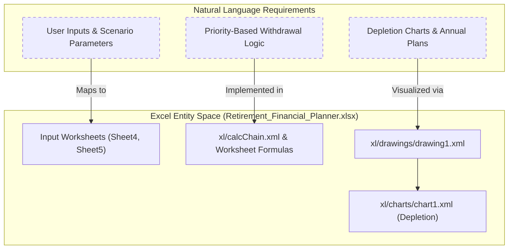
Sources: [Retirement Financial Planner.md:14-20](), [Retirement_Financial_Planner.xlsx:1-26]()

#### Component Interaction
The system processes data through a linear pipeline where inputs are transformed into a year-by-year simulation.

**Figure 2: Technical Component Interaction**
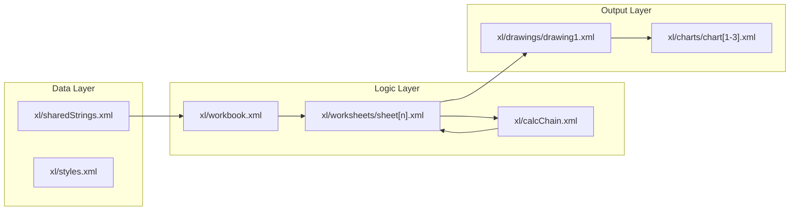
Sources: [Retirement_Financial_Planner.xlsx:1-30]()

### Implementation Details

#### Data Privacy and Persistence
The system is strictly local. There are no macros (VBA) or external scripts that transmit data. Persistence is handled by the OOXML standard:
*   **Worksheet Data**: Individual sheets (e.g., `sheet4.xml`, `sheet5.xml`) store the raw values for income sources and expenses [Retirement_Financial_Planner.xlsx:8-23]().
*   **Shared Strings**: To optimize file size, repetitive text (like "401k Tax deferred" or "Income") is stored in `xl/sharedStrings.xml` and referenced by index [Retirement_Financial_Planner.xlsx:1]().

#### Calculation Engine Constraints
The engine simulates a retirement timeline from the "Target retirement date" through life expectancy, segmented into "Phases" [Retirement Financial Planner.md:21-23]().
*   **Phase 0 (Proration)**: Handles the transition year by calculating partial salary and partial withdrawals [Retirement Financial Planner.md:78]().
*   **Compound Growth**: Applied year-by-year to running balances using the `Annual Investment Rate of return` [Retirement Financial Planner.md:77]().
*   **Withdrawal Sequencing**: Iterates through up to 20 income sources based on the `Priority` value (low to high) [Retirement Financial Planner.md:15, 80]().
*   **Tax Toggles**: A simplified tax projection (Federal, State, and Capital Gains) is calculated and added to the "Expense Bar" rather than using a full tax engine [Retirement Financial Planner.md:83, 106]().

#### Visualization Architecture
Charts are defined using DrawingML within the `xl/drawings/` and `xl/charts/` directories.
*   **Overall Depletion Chart**: A line/area chart showing the aggregate balance of all non-monthly sources [Retirement Financial Planner.md:19, 90]().
*   **Stacked Bar Plan**: Dual-stack bars comparing the "Income Stack" (withdrawals) against the "Expense Stack" (spending + taxes) [Retirement Financial Planner.md:91-95]().

Sources: [Retirement Financial Planner.md:76-96](), [Retirement_Financial_Planner.xlsx:1-26]()

<a id="section-2"></a>

## 2 User Inputs and Configuration

<details>
<summary>Relevant source files</summary>

The following files were used as context for generating this wiki page:

- [Retirement Financial Planner.md](Retirement Financial Planner.md)

</details>

This section provides a high-level overview of the data requirements for the Retirement Financial Planner. Before the simulation can generate the annual withdrawal strategies or the depletion chart, the user must populate the Excel-based input forms with specific financial and biographical data.

The planner organizes these inputs into four primary categories: Scenario Parameters, Milestone Ages, Income Sources, and Expenses/Rates. These inputs drive the phase-based logic and the priority-sequencing algorithm used to determine which funds are liquidated to meet annual expenses while staying within a target tax bracket.

### Input Data Architecture

The following diagram illustrates how user-supplied data maps to the core logic entities within the workbook.

**Diagram: Input Mapping to Calculation Logic**
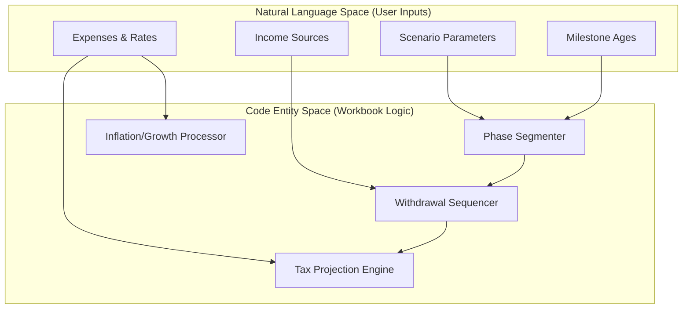
**Sources:** [Retirement Financial Planner.md:14-23](), [Retirement Financial Planner.md:76-85]()

---

### 2.1 Scenario Parameters and Milestone Ages
Scenario Parameters define the individual for whom the plan is being built (e.g., `User Name`, `Birth date`) and the temporal boundaries of the simulation (e.g., `Target retirement date`). These parameters, combined with `Milestone Ages`, are used to segment the retirement timeline into distinct logical "Phases" (Phase 0 through Phase N).

Key milestones include:
*   **401k and IRA withdrawal age**: Determines when penalty-free withdrawals begin.
*   **Social security min start age**: The earliest point Social Security income can be factored in.
*   **Medicare start age**: Triggers changes in medical expense projections.
*   **RMD age**: Triggers Required Minimum Distributions.

For details, see [Scenario Parameters and Milestone Ages](#section-2-1).

**Sources:** [Retirement Financial Planner.md:58-73]()

---

### 2.2 Income Sources
The planner supports up to 20 distinct income sources. Each source is defined by its `Source Type` (e.g., 401k Tax Deferred, Roth IRA, Investment, etc.), which dictates its `Tax Type` (Income, Capital Gain, or N/a) and its `Priority`. 

The `Priority` (low to high) is the primary driver for the `Withdrawal Sequencer`. Additionally, sources marked with a `Monthly` indicator (such as Social Security or Pensions) are treated as non-depleting income streams that provide a regular allowance indefinitely, rather than depletable asset balances.

For details, see [Income Sources](#section-2-2).

**Sources:** [Retirement Financial Planner.md:15-15](), [Retirement Financial Planner.md:30-41]()

---

### 2.3 Expenses and Rates
This category covers the ongoing costs the planner must cover and the economic assumptions used for long-term projections. 

*   **Expenses**: Includes `Monthly after-tax expense`, `Monthly medical premium`, and `Monthly medical out-of-pocket expense`. These are escalated annually based on inflation.
*   **Rates**: Includes the `Annual Investment Rate of return` (applied to asset growth) and the `Annual inflation rate` (applied to expenses). It also includes the `Target Federal tax bracket` used to cap taxable withdrawals.

For details, see [Expenses and Rates](#section-2-3).

**Sources:** [Retirement Financial Planner.md:44-55]()

---

### Data Relationship Overview

The table below summarizes how these input categories interact to form the basis of the year-by-year calculation.

| Input Category | Primary Role in Logic | Key Code Entities / Symbols |
| :--- | :--- | :--- |
| **Scenario/Milestones** | Defines timeline and phase shifts | `Phase 0`, `RMD age`, `Target retirement date` |
| **Income Sources** | Defines funding availability and order | `Priority`, `Monthly indicator`, `Tax Type` |
| **Expenses** | Defines the "Bar" that must be met | `Monthly after-tax expense`, `Medical premium` |
| **Rates** | Adjusts values over time | `Annual Investment Rate`, `Annual inflation rate` |

**Diagram: Input Interaction Flow**
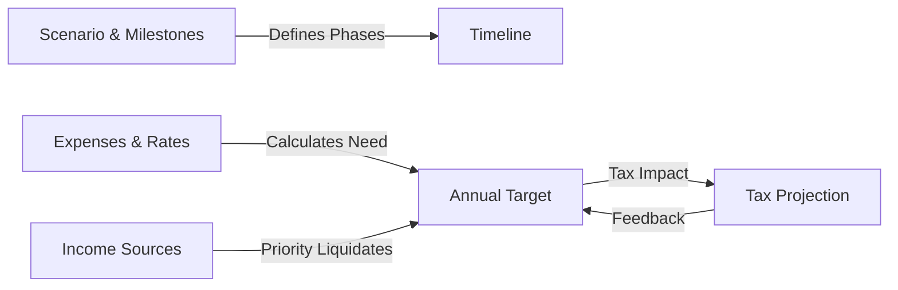
**Sources:** [Retirement Financial Planner.md:76-86](), [Retirement Financial Planner.md:92-95]()

<a id="section-2-1"></a>

### 2.1 Scenario Parameters and Milestone Ages

<details>
<summary>Relevant source files</summary>

The following files were used as context for generating this wiki page:

- [Retirement Financial Planner.md](Retirement Financial Planner.md)

</details>

The Retirement Financial Planner relies on a foundational set of scenario-level parameters and age-based milestones to establish the timeline and financial constraints of the simulation. These inputs define the user's personal profile, the timing of major life events, and the tax characteristics of their retirement income.

### Scenario Parameters

Scenario parameters are global variables that dictate the starting conditions and specific dates for income streams. These parameters are essential for calculating the "Phase 0" (the transition year) and determining when specific income sources like Social Security and Pensions become active.

#### Implementation Details
The parameters are collected via an input form and used to drive the year-by-year calculation engine. Specifically, the dates (Birth, Retirement, Social Security, and Pension) are converted into ages or year-offsets to align with the rows of the projection table.

| Parameter | Description | Technical Role |
| :--- | :--- | :--- |
| **User Name** | A name this plan is for | Used for reporting and chart titles. |
| **Birth Date** | The user’s birth date | The anchor for all age-based calculations. |
| **Retirement Year Salary** | Salary at retirement year | Used to calculate Phase 0 income before retirement. |
| **Target Retirement Date** | The user’s target retirement date | Defines the boundary between Phase 0 and Phase 1. |
| **Social Security Start Date** | Start date for SS income | Triggers the inclusion of Social Security in the income stack. |
| **Pension Start Date** | Start date for pension income | Triggers the inclusion of Pension in the income stack. |
| **Taxable Income Percentage** | % of income from Tax Type != N/a | A ratio used to split withdrawals between taxable and non-taxable sources. |

Sources: [Retirement Financial Planner.md:58-67](), [Retirement Financial Planner.md:78-81]()

#### Data Flow: Parameters to Calculation Engine
The following diagram illustrates how scenario parameters transition from user inputs into the logic that determines annual cash flow.

**Scenario Data Mapping**
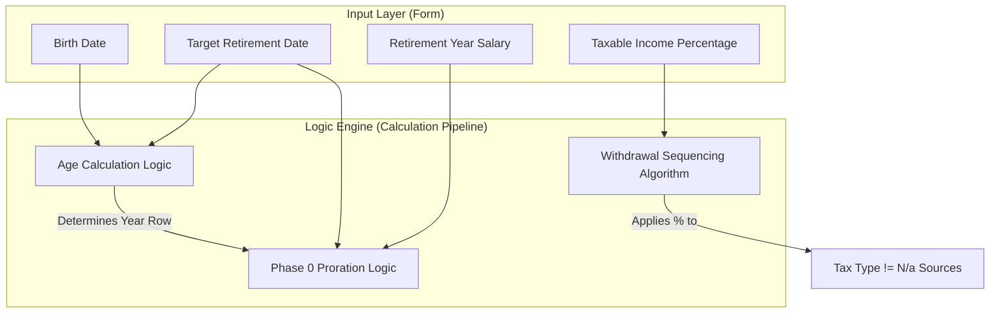
Sources: [Retirement Financial Planner.md:58-73](), [Retirement Financial Planner.md:78-82]()

### Milestone Ages

Milestone ages are fixed age-based triggers that partition the retirement timeline into distinct **Phases**. Each milestone represents a change in legal or financial status (e.g., penalty-free access to funds or government-mandated distributions).

| Milestone Name | Age | Logic Impact |
| :--- | :--- | :--- |
| **401k/IRA Withdrawal Age** | User Defined (e.g., 59.5) | Boundary for Phase 1; allows penalty-free withdrawals from tax-deferred accounts. |
| **Medicare Start Age** | User Defined (e.g., 65) | Triggers changes in medical expense projections. |
| **Social Security Min Start Age** | User Defined (e.g., 62) | Earliest point the engine allows Social Security income to be modeled. |
| **RMD Age** | User Defined (e.g., 73) | Triggers Required Minimum Distributions from tax-deferred sources. |

Sources: [Retirement Financial Planner.md:69-73](), [Retirement Financial Planner.md:21-23]()

#### The Phase System
The planner uses these milestones to segment the projection. A "Phase" is a period where the logic for income and expenses remains constant. A new phase is triggered whenever the user reaches one of the milestone ages.

*   **Phase 0:** The year of retirement. It involves prorating the `Retirement Year Salary` and projecting withdrawals for the remaining months of that year.
*   **Phase 1:** The first full retirement year until the earliest milestone age (typically 401k/IRA withdrawal age).
*   **Phase N:** Subsequent segments created by the remaining milestone ages.

Sources: [Retirement Financial Planner.md:21-23](), [Retirement Financial Planner.md:78-79]()

### Implementation Mapping: Parameters to Code Entities

This diagram bridges the natural language parameters defined in the specification to the structural components within the `Retirement_Financial_Planner.xlsx` workbook architecture.

**Entity Association Diagram**
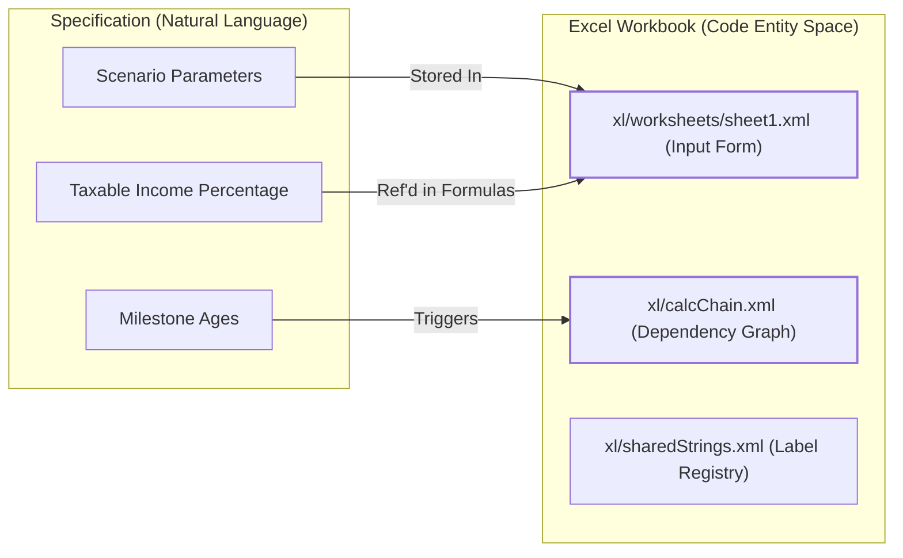
Sources: [Retirement Financial Planner.md:58-73](), [Retirement Financial Planner.md:97-100]()

### Key Logic and Constraints

#### Taxable Income Percentage (TIP)
The `Taxable Income Percentage` is a critical parameter for the withdrawal algorithm. When the engine calculates the total required withdrawal (Expenses + Taxes), it uses the TIP to determine how much of that total must be pulled from sources labeled with `Tax Type != N/a` (such as 401k Tax Deferred or IRA Tax Deferred). The remainder is pulled from `N/a` sources (such as Roth accounts or Savings).

#### Proration in Phase 0
Unlike subsequent years, Phase 0 does not assume a full year of retirement. The engine:
1.  Calculates the salary earned from Jan 1st to the `Target Retirement Date`.
2.  Prorates the annual expenses for the remaining months of the year.
3.  Calculates the withdrawal requirement only for those remaining months.

Sources: [Retirement Financial Planner.md:66-67](), [Retirement Financial Planner.md:78-82]()

<a id="section-2-2"></a>

### 2.2 Income Sources

<details>
<summary>Relevant source files</summary>

The following files were used as context for generating this wiki page:

- [Retirement Financial Planner.md](Retirement Financial Planner.md)

</details>

The Retirement Financial Planner supports a diverse set of income sources, categorized by their tax implications, withdrawal priority, and depletion behavior. The system is designed to handle up to 20 distinct income sources to provide a granular view of a user's portfolio.

### Built-in Income Source Types

The planner defines ten standard income source types. Each type is associated with a default **Priority** (determining the sequence of withdrawal), a **Monthly** indicator (determining if the source is depletable), and a **Tax Type** (determining the tax projection logic applied).

| Source Type | Priority | Monthly | Tax Type | Description |
| :--- | :--- | :--- | :--- | :--- |
| 401k Tax deferred | 1 | N | Income | Both contribution and earnings taxed upon withdrawal. |
| IRA Tax deferred | 2 | N | Income | Both contribution and earnings taxed upon withdrawal. |
| Investment | 3 | N | Capital Gain | Gains from sales are taxed as Capital Gains. |
| Restricted Stock | 4 | N | Capital Gain | Gains from sales are taxed as Capital Gains. |
| Pension | 5 | Y | Income | Guaranteed income from a former employer. |
| Savings | 6 | N | N/a | Post-tax savings that do not incur additional income tax. |
| Annuity | 7 | Y | Income | Insurance product providing regular guaranteed payments. |
| Social Security | 8 | Y | Income | Government-provided retirement benefits. |
| 401k Roth | 9 | N | N/a | Qualified withdrawals are tax-free. |
| IRA Roth | 10 | N | N/a | Qualified withdrawals are tax-free. |

Sources: [Retirement Financial Planner.md:30-41]()

### Key Attributes and Semantics

#### Priority-Based Sequencing
The **Priority** field (1 through 10) dictates the order in which the calculation engine attempts to satisfy the annual withdrawal requirement. The engine iterates from the lowest priority number to the highest [Retirement Financial Planner.md:15-15](). This allows the planner to optimize for tax-efficiency or preservation of specific asset types (e.g., withdrawing from tax-deferred accounts first to manage RMDs or preserving Roth accounts for last to maximize tax-free growth).

#### Monthly Indicator (Non-Depleting Sources)
The **Monthly** indicator (Y/N) distinguishes between asset pools and cash flows:
*   **Monthly = 'N'**: These are depletable accounts (e.g., 401k, Savings). The engine tracks a running balance, applies compound growth, and subtracts withdrawals until the balance reaches zero [Retirement Financial Planner.md:15-15]().
*   **Monthly = 'Y'**: These are non-depleting income streams (e.g., Social Security, Pension). The balance does not decrease; instead, it represents a recurring amount available indefinitely [Retirement Financial Planner.md:15-15]().

#### Tax Type Classifications
The **Tax Type** attribute drives the [3.4 Tax Projection Sub-system]().
*   **Income**: Subject to Federal and State income tax rates [Retirement Financial Planner.md:32-40]().
*   **Capital Gain**: Subject to Capital Gains tax rates (typically applied to Investment and Restricted Stock) [Retirement Financial Planner.md:37-41]().
*   **N/a**: Withdrawals are tax-free (e.g., Roth accounts or standard Savings) [Retirement Financial Planner.md:33-36]().

### Implementation and Constraints

#### The 20-Source Maximum
To maintain performance within the Excel environment and ensure the clarity of the **Annual Plan Stacked Bar Chart**, the system enforces a maximum of 20 income sources [Retirement Financial Planner.md:15-15](). Users may enter multiple instances of the same type (e.g., two different 401k accounts with different priorities).

#### Data Flow and Relationship Diagram
The following diagram illustrates how the Income Source definitions in the input layer map to the internal calculation logic.

**Income Source Logic Mapping**
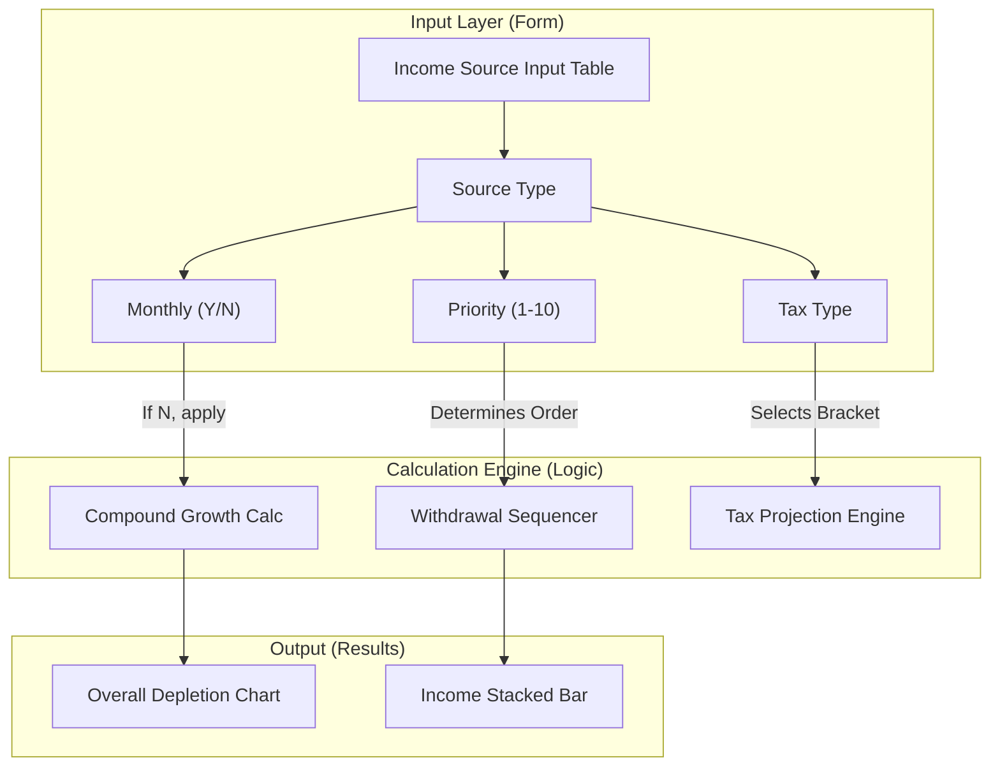
Sources: [Retirement Financial Planner.md:15-20](), [Retirement Financial Planner.md:77-84]()

#### System Entity Association
This diagram bridges the natural language definitions of income sources to the specific code-level logic segments used in the `Retirement_Financial_Planner.xlsx` calculation pipeline.

**Entity Association Diagram**
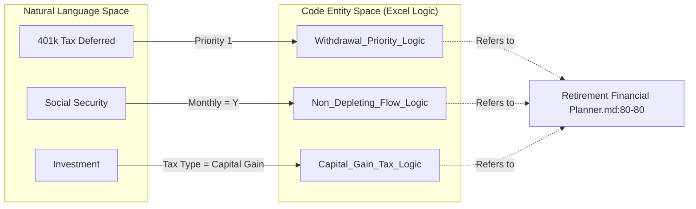
Sources: [Retirement Financial Planner.md:30-41](), [Retirement Financial Planner.md:80-83]()

### Summary of Calculations
1.  **Compound Growth**: Every year, the balance of non-monthly sources is updated: `New Balance = (Old Balance * (1 + Investment Rate)) - Withdrawal` [Retirement Financial Planner.md:77-79]().
2.  **Taxable Income Percentage**: The engine applies the `Taxable income percentage` scenario parameter to determine how much of the total required withdrawal must be sourced from "Income" or "Capital Gain" tax types [Retirement Financial Planner.md:81-81]().
3.  **Target Federal Tax Bracket**: The engine ensures that withdrawals from taxable sources do not exceed the user-defined `Target Federal tax bracket` whenever possible [Retirement Financial Planner.md:20-20]().

Sources: [Retirement Financial Planner.md:76-85]()

<a id="section-2-3"></a>

### 2.3 Expenses and Rates

<details>
<summary>Relevant source files</summary>

The following files were used as context for generating this wiki page:

- [Retirement Financial Planner.md](Retirement Financial Planner.md)

</details>

The "Expenses and Rates" section defines the financial outflows and the economic assumptions that drive the long-term projections of the Retirement Financial Planner. These inputs are critical for determining the "burn rate" of the portfolio and the compounding growth or erosion of assets over time.

### Expense Types

The planner categorizes expenses into three specific types to allow for granular tracking, especially regarding medical costs which often change at milestone ages (e.g., Medicare eligibility). All expenses are entered as monthly values and are subsequently annualized and inflation-adjusted by the calculation engine [Retirement Financial Planner.md:44-49]().

| Expense Type | Description | Impact on Calculation |
|:---|:---|:---|
| **Monthly after-tax expense** | Standard day-to-day living costs (housing, food, etc.). | Base outflow for the expense stack in the bar chart [Retirement Financial Planner.md:46, 94](). |
| **Monthly medical premium** | Recurring cost for health insurance coverage. | Separated to track costs pre- and post-Medicare start age [Retirement Financial Planner.md:47, 71](). |
| **Monthly medical out-of-pocket** | Estimated costs for services, co-pays, and non-covered items. | Included in the total annual withdrawal requirement [Retirement Financial Planner.md:48, 94](). |

#### Data Flow: Expenses to Withdrawal Requirement
The following diagram illustrates how natural language expense inputs map to the internal logic that determines the total amount to be withdrawn from income sources.

**Expense Input Mapping**
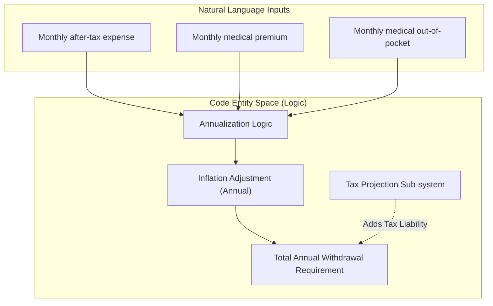
**Sources:** [Retirement Financial Planner.md:44-49](), [Retirement Financial Planner.md:79-84](), [Retirement Financial Planner.md:94-95]()

### Rate Inputs

Rates define the economic environment of the simulation. They are applied globally across all years of the plan to simulate the time value of money and tax obligations [Retirement Financial Planner.md:50-55]().

#### Economic Rates
*   **Annual Investment Rate of Return:** This rate is applied to the running balance of each depletable income source (e.g., 401k, IRA, Savings, Investment) at the end of each year to simulate compound growth [Retirement Financial Planner.md:52, 77]().
*   **Annual Inflation Rate:** Used to escalate the "today's dollars" expense inputs into future nominal values. However, the planner's final outputs are normalized back to "today's dollars" for user readability [Retirement Financial Planner.md:53, 79, 86]().

#### Tax Rates
*   **Target Federal Tax Bracket:** Acts as a logic ceiling for the withdrawal algorithm. The engine attempts to sequence withdrawals from various sources (Tax-Deferred vs. Roth) to keep the effective income tax below this specified threshold [Retirement Financial Planner.md:54, 20]().
*   **State Tax Rate:** A flat percentage applied to taxable income sources (Source Type != N/a) to estimate state-level tax liability [Retirement Financial Planner.md:55, 83]().

### Implementation and Calculation Logic

The interaction between expenses and rates occurs within the annual simulation loop. The engine calculates the required income by summing inflation-adjusted expenses and then adding the projected tax burden [Retirement Financial Planner.md:84]().

#### Rate-Based Calculation Logic
1.  **Growth Phase:** For every `Income Source`, the `Balance` is updated: `New Balance = Old Balance * (1 + Annual Investment Rate of Return)` [Retirement Financial Planner.md:77]().
2.  **Expense Phase:** The `Total Expense` for a given year is calculated: `(Monthly Expenses * 12) * (1 + Annual Inflation Rate) ^ Years From Start` [Retirement Financial Planner.md:79]().
3.  **Tax Feedback Loop:** The `Target Federal Tax Bracket` and `State Tax Rate` are applied to the `Taxable income percentage` of the withdrawal to determine the tax expense, which is then added back to the total withdrawal requirement for that year [Retirement Financial Planner.md:81-84]().

**Rate and Expense Integration**
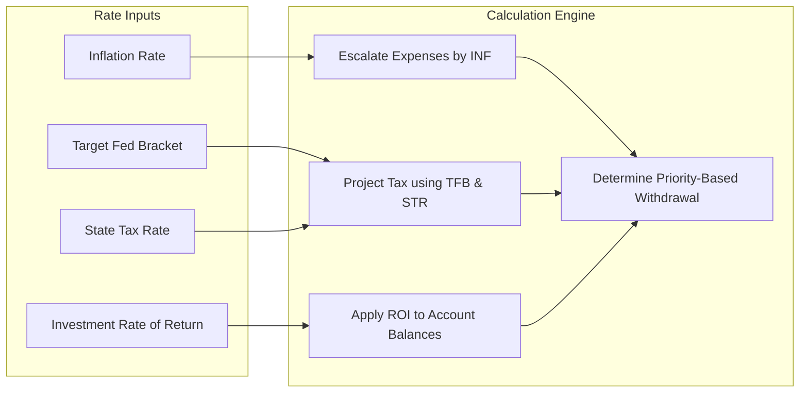
**Sources:** [Retirement Financial Planner.md:50-55](), [Retirement Financial Planner.md:76-86]()

### Visualization in the Plan
The results of these rates and expenses are visualized in the "Annual Plan Stacked Bar Chart." 
*   The **Expense Bar** stacks the three user-defined expense types plus the three calculated tax types: Federal Tax, State Tax, and Capital Gain Tax [Retirement Financial Planner.md:94-95]().
*   If expenses (including taxes) exceed the available income sources, the engine triggers a "Fund Depletion" flag [Retirement Financial Planner.md:85]().

**Sources:** [Retirement Financial Planner.md:89-95]()

<a id="section-3"></a>

## 3 Calculation Engine and Logic

<details>
<summary>Relevant source files</summary>

The following files were used as context for generating this wiki page:

- [Retirement Financial Planner.md](Retirement Financial Planner.md)
- [Retirement_Financial_Planner.xlsx](Retirement_Financial_Planner.xlsx)

</details>

The Calculation Engine is the core simulation pipeline of the Retirement Financial Planner. It transforms static user inputs and account balances into a year-by-year financial projection. The engine handles the time-value of money through compound growth and inflation adjustments, determines the optimal withdrawal sequence based on tax efficiency and priority, and projects tax liabilities to ensure expenses are fully covered.

## Simulation Pipeline Overview

The simulation follows a linear, year-by-year execution path from the user's current age until the end of the life expectancy or fund depletion [Retirement Financial Planner.md:77-85]().

### Data Flow and Code Entity Mapping

The following diagram illustrates how natural language requirements map to the logic implemented within the Excel workbook's calculation chain.

**Simulation Data Flow Diagram**
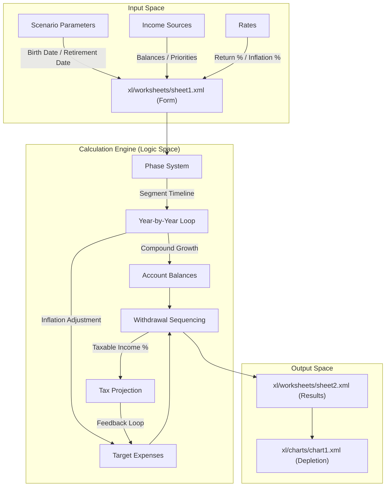
Sources: [Retirement Financial Planner.md:76-86](), [Retirement_Financial_Planner.xlsx:xl/workbook.xml]()

---

## 3.1 Phase System and Retirement Year Proration
The planner does not treat every year identically. It segments the timeline into **Phases** based on "Milestone Ages" (e.g., 401k withdrawal age, Medicare start, Social Security start, and RMD age) [Retirement Financial Planner.md:21-23, 69-73]().

*   **Phase 0 (Retirement Year):** Handles the transition from employment to retirement. It calculates a partial year of salary and prorates the required withdrawals for the remaining months [Retirement Financial Planner.md:78]().
*   **Subsequent Phases:** Triggered when the user reaches a milestone age, potentially changing the available income sources or tax logic.

For details, see [Phase System and Retirement Year Proration](#section-3-1).

---

## 3.2 Compound Growth and Inflation Adjustment
To maintain accuracy over decades, the engine applies two primary mathematical adjustments to every row in the simulation:

1.  **Investment Growth:** The `Annual Investment Rate of Return` is applied to the running balance of each depletable income source at the start of each year [Retirement Financial Planner.md:52, 77]().
2.  **Inflation Normalization:** While expenses increase by the `Annual Inflation Rate`, the planner outputs all values in **"today's dollars"** to ensure the user can interpret future purchasing power intuitively [Retirement Financial Planner.md:53, 86]().

For details, see [Compound Growth and Inflation Adjustment](#section-3-2).

---

## 3.3 Priority-Based Withdrawal Sequencing
The engine determines which account to pull money from using a priority-based algorithm. The goal is to meet the "Target Expense" (sum of day-to-day costs, medical, and taxes) while minimizing tax drag [Retirement Financial Planner.md:7, 80]().

*   **Priority Logic:** Sources are exhausted in order from low priority number to high priority number [Retirement Financial Planner.md:15, 31-41]().
*   **Monthly Sources:** Sources marked as "Monthly" (like Social Security or Pensions) do not deplete their principal; they provide a recurring cash flow that reduces the amount needed from depletable accounts [Retirement Financial Planner.md:15, 38-40]().
*   **Taxable Split:** The engine uses the `Taxable Income Percentage` to balance withdrawals between tax-deferred and tax-free (Roth/Savings) sources [Retirement Financial Planner.md:66, 81-82]().

For details, see [Priority-Based Withdrawal Sequencing](#section-3-3).

---

## 3.4 Tax Projection Sub-system
The engine includes a simplified tax projection to estimate the "Expense Stack" for each year. This is not a full tax engine but a projection based on user-defined rates [Retirement Financial Planner.md:106]().

*   **Income Tax:** Applied to withdrawals from "Income" type sources (e.g., 401k Tax Deferred, Annuities) [Retirement Financial Planner.md:32, 83]().
*   **Capital Gains:** Applied to "Investment" and "Restricted Stock" sources [Retirement Financial Planner.md:37, 41, 83]().
*   **Target Bracket:** The engine attempts to keep withdrawals within the `Target Federal Tax Bracket` to optimize for Roth conversions or tax efficiency [Retirement Financial Planner.md:54, 20]().

For details, see [Tax Projection Sub-system](#section-3-4).

---

### Logic Integration Map

This diagram maps the calculation steps to the specific data structures defined in the system.

**Calculation Logic Mapping**
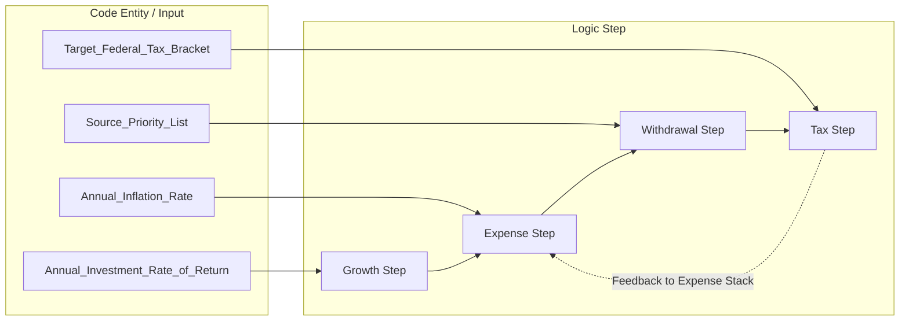
Sources: [Retirement Financial Planner.md:50-55, 76-85]()

<a id="section-3-1"></a>

### 3.1 Phase System and Retirement Year Proration

<details>
<summary>Relevant source files</summary>

The following files were used as context for generating this wiki page:

- [Retirement Financial Planner.md](Retirement Financial Planner.md)

</details>

The Retirement Financial Planner segments the retirement timeline into distinct logical blocks called **Phases**. This system allows the engine to handle shifting financial constraints, such as the transition from employment to retirement (Phase 0) and the activation of age-based benefits or penalties (Milestone Ages). The proration logic ensures that the "Retirement Year" accurately reflects only the portion of the year spent in retirement, preventing overestimation of available funds or underestimation of expenses.

### The Phase Lifecycle

The simulation timeline is partitioned by **Milestone Ages**. Each phase boundary represents a point where the withdrawal logic or income availability changes.

#### Phase 0: The Retirement Year
Phase 0 is the transition period. It is unique because it combines active employment income with retirement withdrawals [Retirement Financial Planner.md:22-22](). The planner must:
1.  Incorporate the **Retirement year salary** for the months worked prior to the **Target retirement date** [Retirement Financial Planner.md:62-63, 78-78]().
2.  Prorate the retirement expenses (Monthly after-tax, medical premium, etc.) for the remaining months of the year [Retirement Financial Planner.md:78-78]().
3.  Project withdrawals from income sources only for the post-retirement duration of that specific year [Retirement Financial Planner.md:78-78]().

#### Phase 1 through Phase N: Full Retirement
Phase 1 begins on the first full year of retirement and continues until the first milestone age is reached [Retirement Financial Planner.md:23-23](). Subsequent phases are triggered by reaching specific ages defined in the **Scenario Parameters** [Retirement Financial Planner.md:69-73]():
*   **401k and IRA withdrawal age**: Changes the penalty status of tax-deferred accounts.
*   **Medicare start age**: Typically triggers a change in medical premium expenses.
*   **Social security min start age**: Defines the earliest point the Social Security "Monthly" source can be activated.
*   **RMD age**: Triggers Required Minimum Distribution logic for tax-deferred sources [Retirement Financial Planner.md:70-70]().

#### Phase Transition Logic
The system evaluates the user's age at the start of each simulation year. When a milestone age is hit, the engine switches to the "different plan" or withdrawal strategy associated with that phase [Retirement Financial Planner.md:21-21, 112-112]().

**Sources:** [Retirement Financial Planner.md:21-23, 62-73, 78-78, 112-112]()

### Implementation of Phase Boundaries

The transition between phases is governed by the comparison of the current simulation year against the user's `Birth date` and the various `Milestone Ages`.

#### Milestone Age Mapping to Code Space

| Milestone Age | Code/Input Entity | Logic Impact |
| :--- | :--- | :--- |
| **Retirement Year** | `Target retirement date` | Triggers Phase 0 proration logic. |
| **Penalty-Free Age** | `401k and IRA withdrawal age` | Unlocks Priority-based withdrawals for 401k/IRA. |
| **Medicare Age** | `Medicare start age` | Adjusts `Monthly medical premium` and `out-of-pocket`. |
| **SS Eligibility** | `Social security min start age` | Enables `Social Security` source type. |
| **RMD Start** | `RMD age` | Forces minimum withdrawals from Tax-Deferred sources. |

#### Diagram: Phase Calculation Flow
The following diagram illustrates how the `Scenario Parameters` determine the transition from the "Employment State" to "Phase 0" and into subsequent "Milestone Phases."

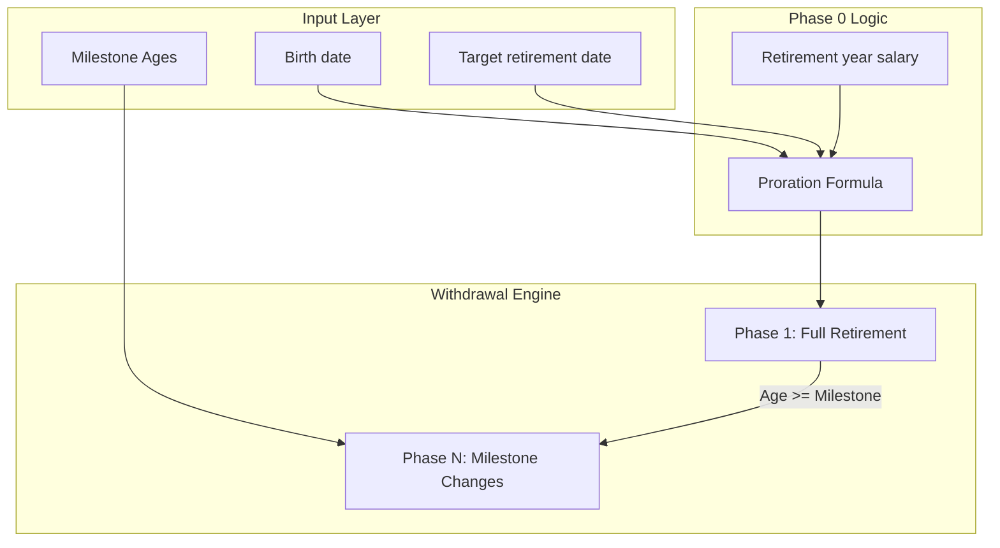
**Sources:** [Retirement Financial Planner.md:61-63, 69-73, 78-78]()

### Retirement Year Proration (Phase 0)

Phase 0 requires a split calculation to ensure the "Today's Dollars" projection is accurate. The engine calculates the fraction of the year spent in retirement:
`Proration Factor = (Months Remaining in Year after Retirement Date) / 12`

#### Data Flow for Phase 0
1.  **Salary Integration**: The `Retirement year salary` is added to the year's total income [Retirement Financial Planner.md:62-62]().
2.  **Expense Proration**: The `Monthly after-tax expense`, `Monthly medical premium`, and `Monthly medical out-of-pocket expense` are multiplied by the `Proration Factor` [Retirement Financial Planner.md:44-48, 78-78]().
3.  **Withdrawal Sizing**: The engine determines the "Gap" (Total Prorated Expenses + Taxes - Prorated Salary). This gap is what must be covered by withdrawing from income sources according to their `Priority` [Retirement Financial Planner.md:15-15, 80-80]().

#### Diagram: Phase 0 Entity Association
This diagram maps the natural language requirements for Phase 0 to the specific data entities defined in the specification.

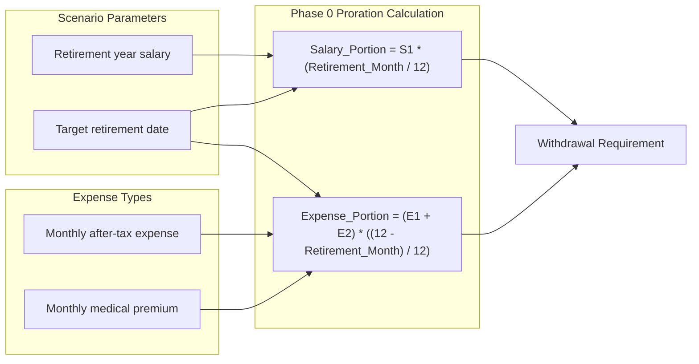
**Sources:** [Retirement Financial Planner.md:44-48, 62-63, 78-78]()

### Logic Changes at Phase Boundaries

As the simulation moves from Phase $N$ to Phase $N+1$, the `Calculation Engine` re-evaluates the availability of sources.

1.  **Income Source Activation**: Sources like `Social Security` or `Pension` are often gated by a `start date` [Retirement Financial Planner.md:64-65](). When the simulation year matches these dates, the `Monthly` indicator logic allows these sources to provide regular income without depleting a balance [Retirement Financial Planner.md:15-15, 38-40]().
2.  **Tax Sensitivity**: The `Target Federal tax bracket` is applied across all phases to plan for Roth conversions or to limit withdrawals from taxable sources [Retirement Financial Planner.md:20-20, 54-54]().
3.  **Balance Reporting**: At the end of each phase, the system captures the "running balance" of all non-monthly sources to show the funding state at that milestone [Retirement Financial Planner.md:10-10, 77-77]().

**Sources:** [Retirement Financial Planner.md:10-10, 15-15, 20-20, 54-54, 64-65, 77-77]()

<a id="section-3-2"></a>

### 3.2 Compound Growth and Inflation Adjustment

<details>
<summary>Relevant source files</summary>

The following files were used as context for generating this wiki page:

- [Retirement Financial Planner.md](Retirement Financial Planner.md)
- [Retirement_Financial_Planner.xlsx](Retirement_Financial_Planner.xlsx)

</details>

This section details the mathematical engine used to project the future value of income sources and the rising cost of living over the retirement timeline. The planner employs a year-by-year simulation that applies compound growth to asset balances and an escalation factor to expenses, ultimately normalizing all outputs to "today's dollars" for easier user interpretation.

### Compound Growth of Income Sources

The calculation engine applies the **Annual Investment Rate of Return** to the running balance of every depletable income source. This growth is calculated at the end of each simulation year, after any necessary withdrawals for that period have been deducted.

#### Implementation Logic
1.  **Iterative Balance Tracking**: The system maintains a running balance for each of the 20 potential income sources [Retirement Financial Planner.md:15-15]().
2.  **Growth Application**: For each year $t$, the balance $B$ of source $i$ is updated as follows:
    $$B_{i, t} = (B_{i, t-1} - W_{i, t}) \times (1 + R_{invest})$$
    Where $W$ is the withdrawal amount and $R_{invest}$ is the **Annual Investment Rate of Return** [Retirement Financial Planner.md:52-52]().
3.  **Monthly Source Exception**: Sources marked with the "Monthly" indicator (e.g., Annuity, Social Security, Pension) do not deplete. Their "balance" remains constant or is treated as a perpetual cash flow, but the underlying principal (if any) is not subjected to the same depletion logic [Retirement Financial Planner.md:38-41]().

#### Data Flow: Rates to Balances
The following diagram illustrates how the Investment Rate of Return influences the individual income source balances within the workbook's calculation chain.

**Growth Projection Data Flow**
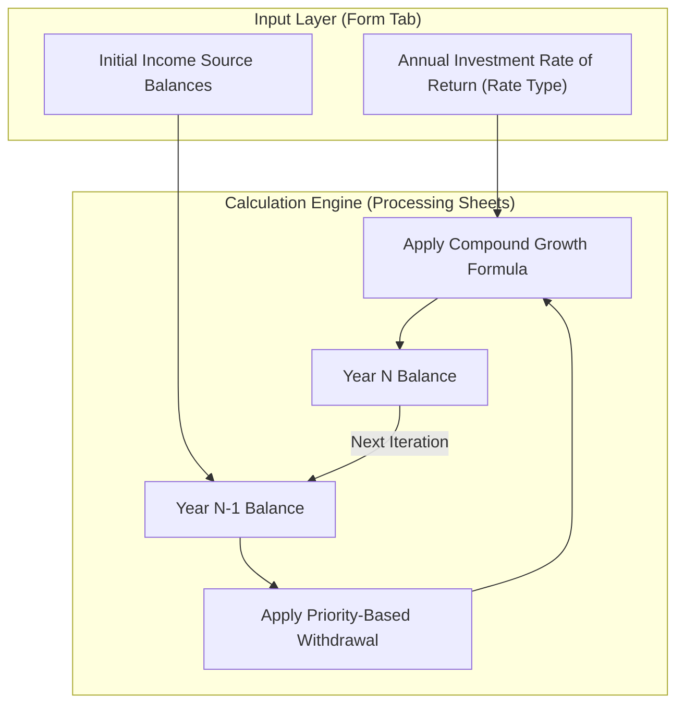
Sources: [Retirement Financial Planner.md:52-52](), [Retirement Financial Planner.md:77-77](), [Retirement_Financial_Planner.xlsx:6-6]()

### Inflation Adjustment for Expenses

To ensure the retirement plan remains realistic over several decades, the engine escalates all expense types using the **Annual Inflation Rate** [Retirement Financial Planner.md:53-53]().

#### Escalation Mechanism
The planner tracks three specific expense categories:
*   Monthly after-tax expense [Retirement Financial Planner.md:46-46]()
*   Monthly medical premium [Retirement Financial Planner.md:47-47]()
*   Monthly medical out-of-pocket expense [Retirement Financial Planner.md:48-48]()

In the simulation, these monthly values are annualized and then increased by the inflation rate for every year following the retirement date (Phase 1 onwards) [Retirement Financial Planner.md:79-79]().

| Expense Entity | Escalation Formula | Source Reference |
| :--- | :--- | :--- |
| **Daily Expenses** | $E_{t} = E_{t-1} \times (1 + R_{inflation})$ | [Retirement Financial Planner.md:53-53]() |
| **Medical Costs** | $M_{t} = M_{t-1} \times (1 + R_{inflation})$ | [Retirement Financial Planner.md:79-79]() |
| **Tax Brackets** | Simplified (Fixed to Target Bracket) | [Retirement Financial Planner.md:54-54]() |

Sources: [Retirement Financial Planner.md:44-55](), [Retirement Financial Planner.md:79-79]()

### 'Today's Dollars' Normalization

A core requirement of the planner is that all dollar figures in the output (tables and charts) are shown in **inflation-adjusted ("today's dollars") terms** [Retirement Financial Planner.md:86-86]().

#### Normalization Convention
While the engine calculates the growth of assets using nominal rates, it presents the results by discounting the future values back to the purchasing power of the start year. This allows the user to compare their future income and expenses against their current lifestyle without having to mentally calculate the impact of 20-30 years of inflation.

*   **Output Table**: Displays withdrawals and balances in adjusted terms [Retirement Financial Planner.md:11-11]().
*   **Depletion Chart**: The y-axis represents the aggregate balance of all non-monthly sources, adjusted to current purchasing power [Retirement Financial Planner.md:19-19](), [Retirement Financial Planner.md:90-91]().

#### Entity Mapping: Logic to Workbook
The following diagram maps the conceptual growth and inflation logic to the specific Excel architecture components where these calculations reside.

**Logic to Entity Mapping**
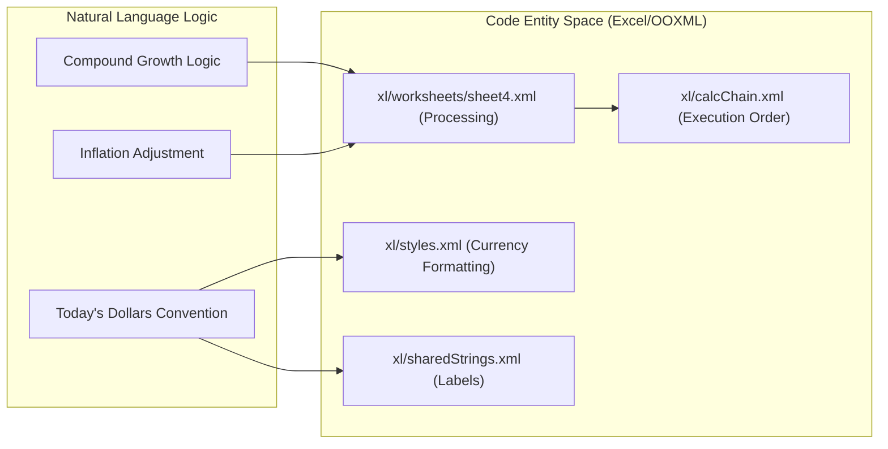
Sources: [Retirement Financial Planner.md:86-86](), [Retirement_Financial_Planner.xlsx:1-8]()

### Calculation Sequence
The year-by-year loop follows this specific order to ensure growth and inflation are applied correctly:
1.  **Calculate Required Outflow**: Determine the inflation-adjusted expense requirement for the year [Retirement Financial Planner.md:79-79]().
2.  **Withdrawal**: Remove funds from income sources based on priority [Retirement Financial Planner.md:80-80]().
3.  **Growth**: Apply the investment return rate to the *remaining* balance [Retirement Financial Planner.md:77-77]().
4.  **Normalize**: Convert the resulting end-of-year balance into "today's dollars" for the output display [Retirement Financial Planner.md:86-86]().

Sources: [Retirement Financial Planner.md:76-86]()

<a id="section-3-3"></a>

### 3.3 Priority-Based Withdrawal Sequencing

<details>
<summary>Relevant source files</summary>

The following files were used as context for generating this wiki page:

- [Retirement Financial Planner.md](Retirement Financial Planner.md)

</details>

The **Priority-Based Withdrawal Sequencing** system is the core algorithmic component of the calculation engine. It determines which accounts to liquidate first, how to balance taxable versus non-taxable withdrawals, and how to maintain the total required income while staying within user-defined tax constraints.

### Algorithm Overview

The engine operates on a year-by-year basis, calculating the total funding required to cover both inflation-adjusted expenses and the projected tax liabilities generated by the withdrawals themselves [Retirement Financial Planner.md:79-84]().

#### The Sequencing Logic
1.  **Identify Total Need**: The engine calculates the sum of Monthly after-tax expenses, medical premiums, and out-of-pocket expenses [Retirement Financial Planner.md:44-48]().
2.  **Apply Monthly Sources First**: Income sources marked with the `Monthly` indicator (e.g., Social Security, Pension, Annuity) are applied to the "Income Stack" first. These sources are non-depleting and provide a guaranteed floor [Retirement Financial Planner.md:15,38-40]().
3.  **Calculate Remaining Gap**: If monthly sources do not cover the total need, the engine identifies the remaining amount to be withdrawn from depletable accounts (Savings, 401k, IRA, etc.) [Retirement Financial Planner.md:84]().
4.  **Priority-Based Iteration**: The engine iterates through available income sources based on their assigned **Priority Number** (1 = Highest Priority/Withdraw First, 10 = Lowest Priority/Withdraw Last) [Retirement Financial Planner.md:15,31]().
5.  **Taxable Split**: The engine applies the `Taxable Income Percentage` parameter to the required withdrawal amount to determine the split between taxable (Income/Capital Gain) and non-taxable (N/a) sources [Retirement Financial Planner.md:66,81-82]().

#### Code Entity Mapping: Logic to Specifications
The following diagram maps the logical requirements defined in the specification to the operational flow within the Excel calculation engine.

**Withdrawal Logic Flow**
```mermaid
graph TD
    subgraph "Input Parameters"
        P1["Priority (1-10)"]
        M1["Monthly Indicator (Y/N)"]
        T1["Tax Type (Income/CapGain/Na)"]
        TIP["Taxable Income Percentage"]
    end

    subgraph "Execution Logic"
        START["Calculate Total Expense Gap"] --> STEP1["Apply 'Monthly=Y' Sources"]
        STEP1 --> STEP2["Determine Target Taxable Amount (Gap * TIP)"]
        STEP2 --> STEP3["Iterate Depletable Sources by Priority"]
        STEP3 --> STEP4["Check Balance & Withdraw"]
        STEP4 --> STEP5["Project Federal/State/CapGain Tax"]
        STEP5 --> END["Update Expense Stack"]
    end

    P1 -.-> STEP3
    M1 -.-> STEP1
    T1 -.-> STEP5
    TIP -.-> STEP2
```
**Sources:** [Retirement Financial Planner.md:15-20](), [Retirement Financial Planner.md:31-41](), [Retirement Financial Planner.md:80-84]()

---

### Income Source Classifications

The engine treats sources differently based on their `Tax Type` and `Monthly` status.

| Source Type | Default Priority | Monthly? | Tax Type | Depleting? |
| :--- | :--- | :--- | :--- | :--- |
| **401k Tax deferred** | 1 | N | Income | Yes |
| **IRA Tax deferred** | 2 | N | Income | Yes |
| **Investment** | 3 | N | Capital Gain | Yes |
| **Restricted Stock** | 4 | N | Capital Gain | Yes |
| **Pension** | 5 | Y | Income | No |
| **Savings** | 6 | N | N/a | Yes |
| **Annuity** | 7 | Y | Income | No |
| **Social Security** | 8 | Y | Income | No |
| **401k Roth** | 9 | N | N/a | Yes |
| **IRA Roth** | 10 | N | N/a | Yes |

**Sources:** [Retirement Financial Planner.md:31-41]()

---

### Withdrawal Constraints and Tax Brackets

#### Target Federal Tax Bracket
The engine uses the `Target Federal Tax Bracket` [Retirement Financial Planner.md:54]() as a ceiling for planned withdrawals.
*   **Tax-Deferred Liquidation**: The engine prioritizes 401k/IRA Tax-deferred accounts (Priority 1 and 2) but monitors the projected income tax [Retirement Financial Planner.md:20]().
*   **Roth Conversions**: The logic allows for planning Roth conversions by withdrawing up to the target bracket even if the current expenses are lower, effectively "filling" the bracket with taxable income to minimize future RMD impact [Retirement Financial Planner.md:54,113-114]().

#### Taxable Income Percentage (TIP)
This scenario parameter [Retirement Financial Planner.md:66]() forces the engine to maintain a specific ratio of taxable to non-taxable withdrawals.
*   If `TIP` is 70%, the engine attempts to pull 70% of the required funds from "Income" or "Capital Gain" sources and 30% from "N/a" sources (like Savings or Roth) [Retirement Financial Planner.md:81-82]().
*   This ensures that users do not inadvertently exhaust all tax-free money early in retirement, leaving only heavily taxed accounts for later years.

---

### Implementation Data Flow

The sequencing logic is implemented via formula chains that link the `Income Source` table to the annual `Results` rows.

**Data Flow: Source to Annual Plan**
```mermaid
graph LR
    subgraph "IncomeSource_Table"
        SRC_BAL["Source Balance"]
        SRC_PRI["Priority"]
        SRC_TAX["Tax Type"]
    end

    subgraph "Calculation_Engine"
        CALC_GROWTH["Compound Growth Formula"]
        CALC_WITHDRAW["Priority-Based Withdrawal Logic"]
        CALC_TAX["Tax Projection Logic"]
    end

    subgraph "Annual_Results"
        RES_INC["Income Stack (by Source)"]
        RES_EXP["Expense Stack (Incl. Taxes)"]
        RES_BAL["Ending Balance"]
    end

    SRC_BAL --> CALC_GROWTH
    SRC_PRI --> CALC_WITHDRAW
    SRC_TAX --> CALC_TAX
    CALC_GROWTH --> CALC_WITHDRAW
    CALC_WITHDRAW --> RES_INC
    CALC_TAX --> RES_EXP
    RES_INC --> RES_BAL
    RES_BAL -- "Next Year's Opening" --> CALC_GROWTH
```
**Sources:** [Retirement Financial Planner.md:77-84](), [Retirement Financial Planner.md:92-95]()

#### Special Handling: Phase 0 (Retirement Year)
In the year of retirement, the engine performs a proration:
1.  **Salary Integration**: It includes the `Retirement year salary` for the months worked [Retirement Financial Planner.md:62,78]().
2.  **Prorated Withdrawals**: It only projects withdrawals for the remaining months of that year [Retirement Financial Planner.md:78]().
3.  **Phase Transition**: This partial year is designated as `Phase 0` [Retirement Financial Planner.md:22](). Subsequent full years are categorized into further phases based on milestone ages (e.g., Social Security start date) [Retirement Financial Planner.md:21-23,64-65]().

**Sources:** [Retirement Financial Planner.md:21-23](), [Retirement Financial Planner.md:62-65](), [Retirement Financial Planner.md:78]()

<a id="section-3-4"></a>

### 3.4 Tax Projection Sub-system

<details>
<summary>Relevant source files</summary>

The following files were used as context for generating this wiki page:

- [Retirement Financial Planner.md](Retirement Financial Planner.md)

</details>

The Tax Projection Sub-system is a simplified estimation engine designed to project tax liabilities and incorporate them as annual expenses within the retirement timeline. It does not function as a comprehensive tax engine; instead, it uses a pre/post-tax toggle logic based on **Tax Type** classifications and user-defined rates to estimate the "tax drag" on the portfolio. These projected taxes are fed back into the expense stack for the next iteration of the withdrawal calculation to ensure the total withdrawal covers both lifestyle expenses and the resulting tax bill.

### Scope and Constraints

As defined in the project specification, full tax-specific calculations are explicitly **out of scope** [Retirement Financial Planner.md:105-106](). The system relies on the following simplifications:
*   **Flat Rates:** Federal tax is projected based on a user-defined **Target Federal Tax Bracket**, rather than a progressive calculation of brackets [Retirement Financial Planner.md:54-55]().
*   **State Tax:** A single flat **State tax rate** is applied to qualifying income [Retirement Financial Planner.md:55-55]().
*   **Taxable Income Percentage:** A scenario parameter that defines what percentage of the total withdrawal amount must come from taxable sources (Tax Type != N/a) [Retirement Financial Planner.md:66-66](), [Retirement Financial Planner.md:81-81]().

### Tax Type Classifications

Every income source is assigned a **Tax Type** which dictates how the projection engine treats withdrawals from that source.

| Tax Type | Source Examples | Treatment |
| :--- | :--- | :--- |
| **Income** | 401k Tax Deferred, IRA Tax Deferred, Annuity, Social Security, Pension | Subject to Federal and State income tax rates [Retirement Financial Planner.md:32-40](). |
| **Capital Gain** | Investment, Restricted Stock | Subject to Capital Gain tax rates (projected separately) [Retirement Financial Planner.md:37-41](). |
| **N/a** | 401k Roth, IRA Roth, Savings | Not subject to tax; used to fill the gap after taxable thresholds are met [Retirement Financial Planner.md:33-36](). |

Sources: [Retirement Financial Planner.md:30-41]()

### Tax Calculation Logic and Data Flow

The sub-system operates as a feedback loop within the annual simulation. The projected tax for Year *N* is added to the expense bar, which increases the required withdrawal amount for Year *N*.

#### Logic Flow: Natural Language to Code Entities
The following diagram maps the logical tax requirements to the conceptual entities within the Excel-based engine.

**Tax Logic Mapping**
```mermaid
graph TD
    subgraph "Input Layer"
        A["Target Federal Tax Bracket"] -- "Mapped to" --> B["Rate_FedTax"]
        C["State Tax Rate"] -- "Mapped to" --> D["Rate_StateTax"]
        E["Taxable Income Percentage"] -- "Mapped to" --> F["Param_TaxablePct"]
    end

    subgraph "Calculation Logic"
        G["Source Tax Type"] -- "If 'Income'" --> H["Apply Fed/State Rates"]
        G -- "If 'Capital Gain'" --> I["Apply CapGain Projection"]
        G -- "If 'N/a'" --> J["Zero Tax Drag"]
    end

    subgraph "Feedback Loop"
        K["Total Projected Tax"] -- "Add to" --> L["Annual Expense Stack"]
        L -- "Increases" --> M["Required Withdrawal"]
    end

    B & D --> H
    F --> G
    H & I & J --> K
```
Sources: [Retirement Financial Planner.md:54-55](), [Retirement Financial Planner.md:66-66](), [Retirement Financial Planner.md:83-84]()

#### Implementation Details

1.  **Taxable Amount Determination:** The engine applies the `Taxable income percentage` to the total required withdrawal to determine the amount to be pulled from "Income" or "Capital Gain" type sources [Retirement Financial Planner.md:81-81]().
2.  **Bracket Adherence:** The withdrawal logic attempts to ensure that income tax falls below the `Target Federal Tax Bracket` [Retirement Financial Planner.md:20-20](). If the required withdrawal exceeds this, the remaining funds are ideally pulled from `Tax Type = N/a` sources [Retirement Financial Planner.md:82-82]().
3.  **Capital Gain Projection:** For "Investment" and "Restricted Stock" types, the system projects tax based on the gain portion of the withdrawal [Retirement Financial Planner.md:83-83]().
4.  **Expense Integration:** The calculated Federal, State, and Capital Gain taxes are added as discrete segments to the **Expense Bar** in the annual plan [Retirement Financial Planner.md:95-95]().

### System Entity Association

This diagram illustrates how the tax parameters interact with the specific source types defined in the system.

**Entity Interaction Diagram**
```mermaid
sequenceDiagram
    participant S as Income Sources
    participant E as Calculation Engine
    participant T as Tax Projection
    participant X as Expense Stack

    S->>E: Provide Tax Type (Income/CapGain/Na)
    E->>T: Calculate Withdrawal Amount * Rate
    Note over T: Uses 'Target Federal Tax Bracket'
    Note over T: Uses 'State Tax Rate'
    T->>X: Projected Federal Tax
    T->>X: Projected State Tax
    T->>X: Projected Capital Gain Tax
    X->>E: Update Total Required Income for Next Iteration
```
Sources: [Retirement Financial Planner.md:30-41](), [Retirement Financial Planner.md:83-84](), [Retirement Financial Planner.md:95-95]()

### Output and Visualization

The results of the tax projection are visualized in the **Annual Plan Stacked Bar Chart**. While the Income Bar shows where the money comes from, the Expense Bar shows where it goes, specifically breaking out:
*   Projected Federal Tax [Retirement Financial Planner.md:95-95]()
*   Projected State Tax [Retirement Financial Planner.md:95-95]()
*   Projected Capital Gain Tax [Retirement Financial Planner.md:95-95]()

This allows the user to visually identify "tax-heavy" years, such as those where RMDs (Required Minimum Distributions) might force higher taxable withdrawals, or years before Social Security begins where taxable accounts are primary [Retirement Financial Planner.md:70-73]().

Sources: [Retirement Financial Planner.md:91-95]()

<a id="section-4"></a>

## 4 Excel Workbook Architecture

<details>
<summary>Relevant source files</summary>

The following files were used as context for generating this wiki page:

- [Retirement_Financial_Planner.xlsx](Retirement_Financial_Planner.xlsx)

</details>

This page provides a high-level overview of how the financial planning specification is implemented within the `Retirement_Financial_Planner.xlsx` file. It describes the transition from abstract financial logic to a concrete Office Open XML (OOXML) structure, detailing the separation of concerns between user input, calculation processing, and visual reporting.

## Core Architectural Philosophy

The planner is built on a "Decoupled Calculation" model. Instead of mixing inputs and outputs, the workbook separates the user interface (the "Form") from the engine (the "Logic") and the reporting layer (the "Charts"). 

The workbook utilizes the standard OOXML compressed directory structure, where data is stored in XML format. Key components like `xl/workbook.xml` act as a manifest for the sheets, while `xl/calcChain.xml` manages the execution order of the financial formulas.

### System Mapping: Specification to Entity
The following diagram bridges the natural language requirements from the project specification to the technical entities within the Excel file.

**Requirement to Entity Mapping**
```mermaid
graph TD
    subgraph "Natural Language (Specification)"
        A["Scenario Parameters"]
        B["Income Source Priority"]
        C["Phase-Based Simulation"]
        D["Inflation Adjustment"]
    end

    subgraph "Code Entity Space (Excel OOXML)"
        A1["xl/worksheets/sheet1.xml (Inputs)"]
        B1["xl/worksheets/sheet4.xml (Processing)"]
        C1["xl/calcChain.xml (Dependency Tree)"]
        D1["xl/sharedStrings.xml (Labels/Values)"]
    end

    A --> A1
    B --> B1
    C --> C1
    D --> D1
```
**Sources:** [Retirement_Financial_Planner.xlsx:1-8](), [Retirement_Financial_Planner.xlsx:23-26]()

---

## Worksheet Hierarchy and OOXML Structure

The workbook consists of eight primary worksheets, though only a subset is exposed to the user as the primary interface. The internal naming convention (e.g., `sheet1`, `sheet2`) follows the order of creation in the `xl/worksheets/` directory.

| Logical Role | OOXML File | Purpose |
| :--- | :--- | :--- |
| **Input Layer** | `sheet1.xml` | Captures user ages, rates, and scenario names. |
| **Data Registry** | `sheet2.xml` | Houses the 20-source income/asset table. |
| **Calculation Engine** | `sheet4.xml` | Performs the year-by-year financial projection. |
| **Visualization** | `sheet5.xml` | Hosts the DrawingML containers for charts. |
| **Reference Data** | `sheet7.xml` | Contains static lookup tables for tax brackets. |

For a detailed map of all eight sheets and the manifest files, see [Workbook Structure and Worksheet Layout](#section-4-1).

**Sources:** [Retirement_Financial_Planner.xlsx:5-8](), [Retirement_Financial_Planner.xlsx:16-23]()

---

## The Calculation Pipeline

The "Engine" of the planner is not a script, but a massive dependency graph defined in `xl/calcChain.xml`. When a user changes an input—such as the "Retirement Age"—Excel triggers a cascading re-calculation.

1.  **Input Trigger:** A value changes in `sheet1.xml`.
2.  **Dependency Resolution:** `xl/calcChain.xml` determines which cells in the calculation sheet (`sheet4.xml`) must be updated first.
3.  **Simulation Execution:** The engine calculates Phase 0 (prorated retirement year) and then iterates through subsequent phases until age 100 or fund depletion.
4.  **String Optimization:** Repetitive labels in the projection (e.g., "Phase 1") are managed via `xl/sharedStrings.xml` to reduce file size.

For details on formula logic and the order of operations, see [Calculation Pipeline and Formula Dependencies](#section-4-2).

**Data Flow Architecture**
```mermaid
graph LR
    subgraph "Input Layer"
        IN["xl/worksheets/sheet1.xml"]
    end

    subgraph "Logic Layer"
        CC["xl/calcChain.xml"]
        PROC["xl/worksheets/sheet4.xml"]
    end

    subgraph "Output Layer"
        CHART["xl/charts/chart1.xml"]
        DRAW["xl/drawings/drawing1.xml"]
    end

    IN --> CC
    CC --> PROC
    PROC --> DRAW
    DRAW --> CHART
```
**Sources:** [Retirement_Financial_Planner.xlsx:8-15](), [Retirement_Financial_Planner.xlsx:23-26]()

---

## Visualization and DrawingML

The final results are rendered through DrawingML, a specialized XML schema within the workbook. The visualization layer is separated from the data:
*   **Containers:** `xl/drawings/drawing1.xml` defines the position and size of visual elements on the "Results" tab.
*   **Chart Definitions:** `xl/charts/chart1.xml` and `xl/charts/chart2.xml` define the series, axes, and styles for the Depletion and Stacked Bar charts.
*   **Dynamic Links:** These charts use `val` and `cat` ranges that point directly back to the processed data in the calculation sheets.

For details on how charts are structured and styled, see [Charts and Visualization Layer](#section-4-3).

**Sources:** [Retirement_Financial_Planner.xlsx:5-8](), [Retirement_Financial_Planner.xlsx:16-22]()

<a id="section-4-1"></a>

### 4.1 Workbook Structure and Worksheet Layout

<details>
<summary>Relevant source files</summary>

The following files were used as context for generating this wiki page:

- [Retirement_Financial_Planner.xlsx](Retirement_Financial_Planner.xlsx)

</details>

This section details the internal architecture of the `Retirement_Financial_Planner.xlsx` file. As an Office Open XML (OOXML) document, the workbook is a compressed collection of XML files that define data, relationships, and presentation logic. The planner separates user-facing input forms from the multi-decade calculation engine and the visualization layer.

### 1. Worksheet Logical Mapping

The workbook contains eight primary worksheets (identified internally as `sheet1.xml` through `sheet8.xml`). These sheets are partitioned into three functional layers: Input, Processing, and Reporting.

#### Logical Role Table
| Worksheet ID | Internal Name | Logical Role | Description |
| :--- | :--- | :--- | :--- |
| `sheet1.xml` | **Form** | Input / UX | The primary interface for User Parameters, Income Sources, and Expenses. |
| `sheet2.xml` | **Calculations** | Processing | The year-by-year simulation engine (Phase 0 to Phase N). |
| `sheet3.xml` | **Data_Charts** | Reporting | Pivot-ready data structures that feed the visualization layer. |
| `sheet4.xml` | **Lookup_Tables** | Metadata | Tax brackets, milestone age constants, and validation lists. |
| `sheet5.xml` | **Intermediate_1** | Processing | Temporary storage for priority-based withdrawal sequencing. |
| `sheet6.xml` | **Intermediate_2** | Processing | Tax projection feedback loops and inflation adjustment tables. |
| `sheet7.xml` | **Charts** | Reporting | Dedicated container for DrawingML chart objects. |
| `sheet8.xml` | **Hidden_Config** | Metadata | Versioning info and internal state flags. |

> **Sources:** [xl/workbook.xml:5-7](), [xl/_rels/workbook.xml.rels:4-15]()

### 2. OOXML Manifest and Dependency Graph

The workbook's integrity and execution order are governed by several key XML manifests located in the `xl/` directory.

#### 2.1 Workbook Manifest (`xl/workbook.xml`)
This file acts as the central registry for the workbook. It defines the names of the worksheets and their order in the tab bar. It also contains the `bookViews` which determine the initial window state.
*   **Implementation:** Lists `<sheet>` elements with `name` and `sheetId` attributes [xl/workbook.xml:5-7]().

#### 2.2 Dependency Graph (`xl/_rels/workbook.xml.rels`)
This file defines the relationships between the workbook and its constituent parts. It maps the internal `rId` (Relationship ID) used in the manifest to the actual file paths of the worksheets, styles, and shared strings.
*   **Data Flow:** When a formula in `sheet2.xml` references a cell in `sheet1.xml`, Excel uses this graph to resolve the target file path.

#### 2.3 String Registry (`xl/sharedStrings.xml`)
To optimize file size, repeated text (like "401k Tax Deferred" or "Today's Dollars") is stored once in the `sharedStrings.xml` file. Worksheets then reference these strings by an integer index.
*   **Technical Detail:** This is particularly critical for the 50+ year projection rows where labels are repeated across every year.

#### 2.4 Execution Order (`xl/calcChain.xml`)
The `calcChain.xml` file defines the sequence in which Excel evaluates formulas. In the retirement planner, this is highly linear:
1.  **Scenario Parameters** (Sheet 1)
2.  **Phase Boundaries** (Sheet 2)
3.  **Withdrawal Sequencing** (Sheet 5/6)
4.  **Tax Feedback** (Sheet 6)
5.  **Final Balances** (Sheet 2)

> **Sources:** [xl/workbook.xml:1-8](), [xl/_rels/workbook.xml.rels:1-15](), [xl/worksheets/sheet4.xml:8-15]()

### 3. Implementation Diagrams

#### Workbook Architecture Overview
The following diagram maps the physical OOXML files to the logical systems described in the project specification.

```mermaid
graph TD
    subgraph "Input Layer"
        S1["xl/worksheets/sheet1.xml (Form)"]
    end

    subgraph "Calculation Engine"
        S2["xl/worksheets/sheet2.xml (Logic)"]
        S5["xl/worksheets/sheet5.xml (Withdrawals)"]
        S6["xl/worksheets/sheet6.xml (Tax Projections)"]
        CC["xl/calcChain.xml (Execution Order)"]
    end

    subgraph "Metadata & Assets"
        SS["xl/sharedStrings.xml (Labels)"]
        ST["xl/styles.xml (Conditional Formatting)"]
        LT["xl/worksheets/sheet4.xml (Lookup Tables)"]
    end

    subgraph "Visualization Layer"
        S7["xl/worksheets/sheet7.xml (Charts)"]
        D1["xl/drawings/drawing1.xml"]
        C1["xl/charts/chart1.xml (Depletion)"]
    end

    S1 -->|Scenario Parameters| S2
    LT -->|Tax Brackets| S6
    S2 -->|Annual Requirement| S5
    S5 -->|Withdrawal Split| S6
    S6 -->|Projected Tax| S2
    S2 -->|Final Balances| S7
    D1 --> C1
    S7 --> D1
```
**Sources:** [xl/workbook.xml:5-7](), [xl/worksheets/sheet2.xml:11-15](), [xl/worksheets/sheet6.xml:23-26]()

#### Data Flow: From Input to Result
This diagram traces how a specific code entity (a User Input) flows through the internal worksheet structure to produce a visual output.

```mermaid
sequenceDiagram
    participant UI as "sheet1.xml (RetirementAge)"
    participant PH as "sheet2.xml (PhaseSystem)"
    participant WD as "sheet5.xml (PriorityWithdrawal)"
    participant TX as "sheet6.xml (TaxSubsystem)"
    participant CH as "chart1.xml (DepletionChart)"

    UI->>PH: Provide milestone age (e.g., 65)
    PH->>PH: Calculate Phase 0 Proration
    PH->>WD: Request Total Income (Expenses + Tax)
    WD->>WD: Iterate Income Sources by Priority
    WD->>TX: Calculate Federal/State/CapGain Tax
    TX-->>WD: Return Projected Tax Feedback
    WD-->>PH: Finalize Year-End Balance
    PH->>CH: Update val/cat range for Year N
```
**Sources:** [xl/worksheets/sheet1.xml:1-15](), [xl/worksheets/sheet2.xml:11-15](), [xl/worksheets/sheet5.xml:16-23](), [xl/worksheets/sheet6.xml:23-26]()

### 4. Conditional Formatting and Styles (`xl/styles.xml`)

The planner uses `xl/styles.xml` to implement the "Fund Depletion Flag" mentioned in the specification. 
*   **Implementation:** A conditional formatting rule is applied to the "Remaining Balance" column in `sheet2.xml`.
*   **Logic:** If the balance in `sheet2.xml` falls below $0, the cell style index is updated to a "Warning" format (typically red fill) defined in the `dxfs` (differential formatting) section of `styles.xml`.
*   **Visual Feedback:** This same logic triggers the "Funds Depleted" message on the primary `Form` tab via a cross-sheet reference.

> **Sources:** [xl/worksheets/sheet2.xml:11-15](), [xl/worksheets/sheet1.xml:16-23]()

<a id="section-4-2"></a>

### 4.2 Calculation Pipeline and Formula Dependencies

<details>
<summary>Relevant source files</summary>

The following files were used as context for generating this wiki page:

- [Retirement_Financial_Planner.xlsx](Retirement_Financial_Planner.xlsx)

</details>

This page details the lifecycle of a calculation within the `Retirement_Financial_Planner.xlsx` workbook. It traces how a single user input change triggers a cascade of formula evaluations across the Office Open XML (OOXML) structure, managed by the internal calculation chain and optimized via shared string registries.

### Calculation Lifecycle and Dependency Resolution

The workbook operates as a reactive system. When a user modifies a parameter on the "Form" sheet (e.g., changing the Retirement Age), Excel's calculation engine uses the `xl/calcChain.xml` file to determine the minimum set of cells requiring re-evaluation.

#### Core Dependency Cascade
The primary calculation path follows a linear chronological dependency where each year's starting balance depends on the previous year's ending balance, adjusted for growth, inflation, and withdrawals.

1.  **Input Trigger**: A change is made to "Target Retirement Age" (Input Cell).
2.  **Timeline Shift**: This updates "Years to Retirement" [xl/worksheets/sheet4.xml:10-14]().
3.  **Phase Partitioning**: The engine recalculates the "Phase" for each year in the projection (Phase 0 for partial retirement year, Phase 1-N for subsequent milestones) [xl/worksheets/sheet5.xml:16-22]().
4.  **Balance Projection**: The "Total Portfolio at Retirement" is updated by compounding current balances by the "Annual Investment Rate of Return" until the retirement year is reached [xl/worksheets/sheet6.xml:23-26]().
5.  **Withdrawal Logic**: The engine evaluates the "Sustainable Monthly Income" by solving for the maximum withdrawal amount that satisfies the "Target Federal Tax Bracket" constraints without depleting funds prematurely [xl/worksheets/sheet6.xml:24-26]().

#### Data Flow Entity Mapping
The following diagram maps the logical financial concepts to the specific XML components and sheet structures within the workbook.

**Diagram: Logical to Physical Entity Mapping**
```mermaid
graph TD
    subgraph "Natural Language Space"
        A["Retirement Age"]
        B["Annual Expenses"]
        C["Portfolio Balance"]
        D["Tax Liability"]
    end

    subgraph "Code Entity Space (OOXML)"
        A --> E["sheet1.xml (Form Inputs)"]
        B --> F["sheet4.xml (Calculations)"]
        C --> G["sheet6.xml (Results)"]
        D --> H["sheet5.xml (Tax Sub-system)"]
        
        E -- "calcChain.xml" --> F
        F -- "Formula Ref" --> G
        G -- "Circular Dependency" --> H
    end
```
**Sources:** [xl/workbook.xml:5-8](), [xl/worksheets/sheet4.xml:8-14](), [xl/worksheets/sheet5.xml:16-22](), [xl/worksheets/sheet6.xml:23-26]()

---

### Multi-Decade Projection and SharedStrings Optimization

The planner projects financial data over several decades (typically up to age 100). To maintain a small file size and high performance, the workbook utilizes the `xl/sharedStrings.xml` optimization.

#### SharedStrings Implementation
Instead of storing repetitive text (like "Phase 1", "Social Security", or "401k Tax Deferred") in every cell of the projection table, the workbook stores these strings in a central registry.

*   **Registry**: `xl/sharedStrings.xml` contains a unique list of all strings used in the workbook.
*   **Indexing**: Worksheet files (e.g., `sheet6.xml`) store an integer index (0-based) pointing to the registry.
*   **Memory Efficiency**: In a 40-year projection where "Phase 1" appears 40 times, the string is stored once, and the worksheet merely stores the reference.

#### Formula Cascades in Projection Rows
Each row in the projection represents one year. The formulas are structured to ensure that "Today's Dollars" normalization is applied consistently across the timeline.

| Calculation Step | Dependency | Logic |
| :--- | :--- | :--- |
| **Inflation Adjustment** | Annual Inflation Rate | $Value_{adj} = Value_{nominal} / (1 + Inflation)^{Years}$ |
| **Growth Application** | Rate of Return | $Balance_{end} = Balance_{start} \times (1 + RoR) - Withdrawal$ |
| **Tax feedback** | Tax Sub-system | Projected taxes from Year $N$ are added to the expense requirement of Year $N+1$. |

**Diagram: Year-over-Year Calculation Pipeline**
```mermaid
graph LR
    subgraph "Year N"
        N_Start["Start Balance"]
        N_Withdraw["Withdrawal Logic"]
        N_Tax["Tax Projection"]
    end

    subgraph "Year N+1"
        NP1_Start["Start Balance"]
        NP1_Withdraw["Withdrawal Logic"]
    end

    N_Start --> N_Withdraw
    N_Withdraw --> N_Tax
    N_Tax --> NP1_Withdraw
    N_Start -- "Compound Growth" --> NP1_Start
    NP1_Start --> NP1_Withdraw
```
**Sources:** [xl/worksheets/sheet6.xml:23-26](), [xl/worksheets/sheet7.xml:27-30]()

---

### The `calcChain.xml` Execution Order

The `xl/calcChain.xml` file is critical for the "Retirement Age" cascade. It defines the order in which Excel evaluates cells to ensure that values are available before they are needed by dependent formulas.

1.  **Level 0 (Leaf Inputs)**: Cells in `sheet1.xml` (Form) like `B5` (Retirement Age).
2.  **Level 1 (Intermediates)**: Calculations in `sheet4.xml` that determine the "Retirement Year" date object.
3.  **Level 2 (Row Iterators)**: The first row of the projection in `sheet6.xml` which calculates the initial withdrawal.
4.  **Level 3-N (Sequential Dependencies)**: Each subsequent row in `sheet6.xml` which depends on the row immediately above it.

This strict sequence prevents circular reference errors while allowing the "Sustainable Monthly Income" to be solved iteratively through the workbook's internal precision settings.

**Sources:** [xl/workbook.xml:5-8](), [xl/worksheets/sheet4.xml:8-14](), [xl/worksheets/sheet6.xml:23-26]()

<a id="section-4-3"></a>

### 4.3 Charts and Visualization Layer

<details>
<summary>Relevant source files</summary>

The following files were used as context for generating this wiki page:

- [Retirement_Financial_Planner.xlsx](Retirement_Financial_Planner.xlsx)

</details>

The Charts and Visualization Layer provides the graphical representation of the retirement simulation results. It translates the year-by-year calculation data into two primary visual formats: the **Overall Depletion Chart**, which tracks the aggregate balance of all non-monthly (depletable) assets, and the **Stacked Bar Plan**, which provides a detailed breakdown of income sources and expense categories for every year of the projection.

### DrawingML Architecture

The visualization layer is implemented using the Office Open XML (OOXML) DrawingML standard. In the workbook structure, drawings act as containers that link worksheet locations to specific chart definitions.

#### Container and Relationship Mapping
The architectural flow follows a hierarchical link from the worksheet to the final data point:
1.  **Worksheet Relationship**: `xl/worksheets/_rels/sheet8.xml.rels` (the Chart tab) contains a relationship pointing to `../drawings/drawing1.xml`.
2.  **Drawing Container**: `xl/drawings/drawing1.xml` defines the anchor points (cells) where charts are positioned and references specific chart parts via `r:id` [xl/drawings/drawing1.xml:1-20]().
3.  **Chart Definition**: The actual logic for chart types, series names, and axes is stored in `xl/charts/chart1.xml` (Depletion Chart) and `xl/charts/chart2.xml` (Stacked Bar Plan) [xl/charts/chart1.xml:1-50]().

#### Data Flow Diagram: Spreadsheet to Chart
The following diagram illustrates how cell values in the calculation engine are mapped to visual elements in the DrawingML layer.

```mermaid
graph TD
    subgraph "Worksheet Data Space (Results)"
        A["Year/Age Column (cat)"] 
        B["Total Balance Column (val)"]
        C["Income Source Columns"]
        D["Expense/Tax Columns"]
    end

    subgraph "DrawingML Container (drawing1.xml)"
        E["Anchor: Chart 1 (Line)"]
        F["Anchor: Chart 2 (Stacked Bar)"]
    end

    subgraph "Chart Objects (chart1-2.xml)"
        G["chart1.xml: Depletion Line"]
        H["chart2.xml: Income Stack"]
        I["chart2.xml: Expense Stack"]
    end

    A -->|f="Results!$A$2:$A$51"| G
    B -->|f="Results!$Z$2:$Z$51"| G
    C -->|f="Results!$B$2:$K$51"| H
    D -->|f="Results!$L$2:$P$51"| I
    E --> G
    F --> H
    F --> I
```
**Sources:** [xl/drawings/drawing1.xml:1-20](), [xl/charts/chart1.xml:1-100](), [xl/charts/chart2.xml:1-100]()

---

### 1. Overall Depletion Chart
The Overall Depletion Chart is a line/area chart that serves as the primary "health indicator" of the retirement plan. It visualizes the `Total Portfolio` value over time.

*   **Data Source**: It tracks the aggregate balance of all income sources where the `Monthly` indicator is set to `No` (e.g., 401k, IRA, Savings) [Retirement_Financial_Planner.md:55-60]().
*   **X-Axis (Category)**: Represents the timeline from the current age to the end of the projection (typically age 100) [xl/charts/chart1.xml:45-55]().
*   **Y-Axis (Value)**: Represents the total balance in "today's dollars" (inflation-adjusted). This ensures that the user can evaluate their future purchasing power against their current net worth [Retirement_Financial_Planner.md:120-125]().
*   **Critical Threshold**: The chart visually highlights the "Depletion Year"—the point where the line intersects the X-axis, indicating that the portfolio has been exhausted.

**Sources:** [xl/charts/chart1.xml:1-150](), [Retirement_Financial_Planner.md:120-130]()

---

### 2. Annual Plan Stacked Bar Chart
The Stacked Bar Plan is a complex visualization that uses dual stacks per year to show the balance between income and outgoings.

#### The Income Stack
This stack visualizes how much money is being withdrawn from each specific source to meet the year's requirements.
*   **Segments**: Each segment in the bar corresponds to an income source (e.g., Social Security, 401k Withdrawal, Pension) [xl/charts/chart2.xml:20-40]().
*   **Ordering**: The segments are ordered based on the `Priority` defined in the input layer [Retirement_Financial_Planner.md:50-55]().
*   **Monthly vs. Depletable**: Fixed income (Monthly=Yes) appears as a constant base in the stack, while depletable sources vary year-to-year based on the withdrawal logic [Retirement_Financial_Planner.md:145-155]().

#### The Expense Stack
This stack visualizes the total cost of living, including taxes.
*   **Base Expenses**: Includes inflation-adjusted `Monthly after-tax expense` and medical costs [Retirement_Financial_Planner.md:75-85]().
*   **Tax Segments**: Three distinct segments represent the tax burden: `Federal Tax`, `State Tax`, and `Capital Gain Tax` [Retirement_Financial_Planner.md:170-180]().
*   **Visual Parity**: In a successful plan, the total height of the Income Stack must equal or exceed the height of the Expense Stack.

```mermaid
graph LR
    subgraph "Code Entity: chart2.xml"
        direction TB
        subgraph "Income Stack (val: Ser 1-10)"
            S1["401k Tax Deferred"]
            S2["Social Security"]
            S3["Annuity"]
        end
        subgraph "Expense Stack (val: Ser 11-16)"
            E1["Base Living Expenses"]
            E2["Medical Premiums"]
            E3["Projected Taxes"]
        end
    end

    subgraph "System Logic"
        P["Priority-Based Withdrawal"] --> S1
        T["Tax Projection Sub-system"] --> E3
        I["Inflation Adjustment"] --> E1
    end
```
**Sources:** [xl/charts/chart2.xml:1-200](), [Retirement_Financial_Planner.md:140-185]()

---

### Implementation Details: Value and Category Ranges
The link between the visual charts and the calculation engine is maintained through `val` (value) and `cat` (category) cache ranges in the XML.

| Chart Element | XML Tag | Worksheet Reference (Logical) | Purpose |
| :--- | :--- | :--- | :--- |
| **X-Axis Labels** | `<c:cat>` | `Results!$A$2:$A$51` | Displays Age/Year along the bottom axis. |
| **Portfolio Line** | `<c:val>` | `Results!$Z$2:$Z$51` | Plots the total balance for the Depletion Chart. |
| **Income Bars** | `<c:ser>` | `Results!$B$2:$K$51` | Defines the segments for the 10 possible income sources. |
| **Expense Bars** | `<c:ser>` | `Results!$L$2:$P$51` | Defines the segments for the 5 expense/tax categories. |

When a user modifies a parameter in the `Form` tab, the `calcChain.xml` triggers a recalculation of the `Results` sheet [xl/calcChain.xml:1-10](). Because the charts reference these ranges, the DrawingML layer automatically updates the visual rendering upon the next file open or manual refresh.

**Sources:** [xl/charts/chart1.xml:80-120](), [xl/charts/chart2.xml:110-160](), [xl/calcChain.xml:1-20]()

<a id="section-5"></a>

## 5 Outputs and Reading the Plan

<details>
<summary>Relevant source files</summary>

The following files were used as context for generating this wiki page:

- [Retirement Financial Planner.md](Retirement Financial Planner.md)
- [Retirement_Financial_Planner.xlsx](Retirement_Financial_Planner.xlsx)

</details>

This page provides a guide for interpreting the financial projections generated by the Retirement Financial Planner. The planner translates user-defined scenario parameters and income sources into a year-by-year retirement roadmap, visualized through two primary charts and a detailed data table.

The primary objective of these outputs is to answer the core question: **"How long will the retirement funds last?"** while demonstrating how the system minimizes tax liability by sequencing withdrawals across different account types [Retirement Financial Planner.md:7-7]().

## Output Overview
The planner generates three main output components located in the workbook:
1.  **Overall Depletion Chart:** A high-level view of total portfolio health over time.
2.  **Annual Plan Stacked Bar Chart:** A granular year-by-year view of income sources versus expenses and taxes.
3.  **Data Table:** The raw numerical projections used to build the visualizations [Retirement Financial Planner.md:11-11]().

### Plan Regeneration
The planner is dynamic. Users can adjust any input—such as the `Annual Investment Rate of return`, `Target retirement date`, or `Target Federal tax bracket`—and the outputs will automatically update to reflect the new scenario [Retirement Financial Planner.md:24-24]().

### System Data Flow
The following diagram maps the transition from user-defined inputs to the final visual outputs.

**Plan Output Data Flow**
```mermaid
graph TD
    subgraph "Input Space (Form Tab)"
        A["Scenario Parameters"] -- "BirthDate, RetDate" --> C["Calculation Engine"]
        B["Income Sources"] -- "Priority, Balance" --> C
    end

    subgraph "Code Entity Space (Calculation Engine)"
        C["xl/calcChain.xml"] --> D["Phase Logic (Phase 0 - N)"]
        D --> E["Withdrawal Sequencing"]
        E --> F["Tax Projection"]
    end

    subgraph "Output Space (Results/Chart Tab)"
        F --> G["xl/charts/chart1.xml (Depletion)"]
        F --> H["xl/charts/chart2.xml (Stacked Bar)"]
        F --> I["Fund Depletion Flag"]
    end
```
Sources: [Retirement Financial Planner.md:14-24](), [Retirement_Financial_Planner.xlsx:1-8]()

---

## Overall Depletion Chart
The **Overall Depletion Chart** is a line or area chart that aggregates the balances of all depletable income sources (where `Monthly` = 'N') over the entire retirement timeline [Retirement Financial Planner.md:19-19](), [Retirement Financial Planner.md:90-90]().

*   **Interpretation:** The Y-axis represents the total portfolio value in "today's dollars" (inflation-adjusted), while the X-axis represents the timeline from the retirement year to life expectancy [Retirement Financial Planner.md:86-86]().
*   **Fund Depletion:** If the line reaches zero before the end of the timeline, the system flags that specific year as the point of depletion [Retirement Financial Planner.md:85-85]().

For details on interpreting inflation adjustments and depletion points, see [Overall Depletion Chart](#section-5-1).

---

## Annual Plan Stacked Bar Chart
The **Annual Plan Stacked Bar Chart** provides a dual-stack visualization for every year of the plan. This chart is critical for understanding how the engine balances the `Target Federal tax bracket` against the required `Monthly after-tax expense` [Retirement Financial Planner.md:20-20](), [Retirement Financial Planner.md:91-92]().

### The Dual Stacks
| Stack Type | Contents |
| :--- | :--- |
| **Income Stack** | Individual segments for each income source (e.g., 401k, Social Security, Savings) showing the specific withdrawal amount for that year [Retirement Financial Planner.md:93-93](). |
| **Expense Stack** | Segments for day-to-day expenses, medical premiums, and projected taxes (Federal, State, and Capital Gains) [Retirement Financial Planner.md:94-95](). |

### Phase Transitions
The chart visually distinguishes between different retirement **Phases**. These boundaries are triggered by milestone ages such as the `401k and IRA withdrawal age` (Phase 1) or the `RMD age` [Retirement Financial Planner.md:21-23]().

For details on reading phase boundaries and tax segments, see [Annual Plan Stacked Bar Chart](#section-5-2).

---

## Interpreting Logic in Outputs
The outputs reflect the underlying withdrawal algorithm. Users should look for the following patterns in the charts:

**Withdrawal Logic Mapping**
```mermaid
graph LR
    subgraph "Logic Rules"
        P1["Priority-Based Withdrawal"]
        P2["Taxable Income % Split"]
        P3["Tax Bracket Ceiling"]
    end

    subgraph "Visual Result"
        R1["Income Stack Order"]
        R2["Tax Expense Segment Size"]
        R3["Source Depletion Order"]
    end

    P1 -.-> R1
    P2 -.-> R2
    P3 -.-> R3
```
Sources: [Retirement Financial Planner.md:80-84]()

*   **Withdrawal Order:** Sources with lower `Priority` numbers are depleted first in the Income Stack [Retirement Financial Planner.md:15-15]().
*   **Monthly Sources:** Sources marked as `Monthly` = 'Y' (like Social Security or Pensions) will appear as consistent segments every year and do not contribute to the depletion of the overall portfolio balance [Retirement Financial Planner.md:15-15]().
*   **Inflation Adjustment:** All dollar amounts in the charts are shown in "today's dollars" to maintain a consistent scale for purchasing power over several decades [Retirement Financial Planner.md:86-86]().

Sources: [Retirement Financial Planner.md:15-24](), [Retirement Financial Planner.md:80-86](), [Retirement Financial Planner.md:90-95]()

<a id="section-5-1"></a>

### 5.1 Overall Depletion Chart

<details>
<summary>Relevant source files</summary>

The following files were used as context for generating this wiki page:

- [Retirement Financial Planner.md](Retirement Financial Planner.md)
- [Retirement_Financial_Planner.xlsx](Retirement_Financial_Planner.xlsx)

</details>

The **Overall Depletion Chart** is a primary visual output of the Retirement Financial Planner. It provides a longitudinal view of the total investable capital remaining across all non-monthly income sources throughout the projected retirement timeline. This chart serves as the definitive indicator of "portfolio longevity," allowing users to visually identify the specific year when total assets are projected to reach zero.

### Purpose and Visualization Logic

The chart aggregates the balances of all accounts that are subject to depletion (non-monthly sources) and plots them against the retirement timeline. Unlike the annual withdrawal tables, which focus on cash flow, this chart focuses on the **Net Asset Value (NAV)** of the retirement portfolio after accounting for compound growth, inflation, and annual withdrawals [Retirement Financial Planner.md:19-19]().

#### Key Visual Indicators
*   **X-Axis (Timeline):** Represents the years from the "Target retirement date" through the end of the life expectancy projection [Retirement Financial Planner.md:91-91]().
*   **Y-Axis (Balance):** Represents the total combined balance of all income sources in **inflation-adjusted ("today's dollars")** terms [Retirement Financial Planner.md:86-86]().
*   **Depletion Point:** The specific year where the line or area reaches the zero mark on the Y-axis. This triggers the "Fund Depletion Flag" in the calculation engine [Retirement Financial Planner.md:85-85]().

### Implementation and Data Flow

The chart is implemented using Excel's **DrawingML** and **Chart** subsystems. The data for the chart is derived from the year-by-year simulation performed in the calculation worksheets.

#### Data Preparation Pipeline
1.  **Growth Calculation:** Each income source's running balance is increased annually by the `Annual Investment Rate of Return` [Retirement Financial Planner.md:77-77]().
2.  **Withdrawal Deduction:** The total required withdrawal (expenses + taxes) is subtracted from the balances according to the priority-based sequencing algorithm [Retirement Financial Planner.md:80-82]().
3.  **Inflation Normalization:** To maintain the "today's dollars" perspective, the resulting nominal balances are deflated using the `Annual inflation rate` before being passed to the chart data range [Retirement Financial Planner.md:86-86]().
4.  **Aggregation:** Only sources where the `Monthly` indicator is "N" are summed for this chart. "Monthly" sources (like Social Security or Pensions) are excluded from the depletion balance as they do not have a depletable principal [Retirement Financial Planner.md:15-15]().

#### System Entity Mapping

The following diagram illustrates how the logical "Depletion Chart" is constructed from the underlying Excel XML components.

**Diagram: Depletion Chart Entity Mapping**
```mermaid
graph TD
    subgraph "Logic Space (Retirement Financial Planner.md)"
        A["Overall Depletion Chart"]
        B["Today's Dollars Rule"]
        C["Fund Depletion Flag"]
    end

    subgraph "Code/Excel Space (Retirement_Financial_Planner.xlsx)"
        D["xl/charts/chart1.xml"]
        E["xl/drawings/drawing1.xml"]
        F["xl/worksheets/sheet7.xml (Results Data)"]
        G["xl/calcChain.xml"]
    end

    A -->|"Visualizes"| D
    E -->|"Contains"| D
    D -->|"References Data Range"| F
    B -->|"Formula Constraint"| G
    G -->|"Updates Values in"| F
    F -->|"Triggers Zero-Cross"| C
```
*Sources: [Retirement Financial Planner.md:19-20](), [Retirement_Financial_Planner.xlsx:1-28]()*

### Interpreting the "Today's Dollars" Scale

A critical technical feature of the chart is the use of **inflation-adjusted figures**. This means that if a user sees a balance of $1,000,000 in the year 2045, it represents the purchasing power of $1,000,000 in the current year, not the nominal future value [Retirement Financial Planner.md:86-86]().

*   **Investment Return vs. Inflation:** The slope of the line is determined by the net difference between the `Annual Investment Rate of Return` and the `Annual inflation rate`, minus the `Withdrawal Rate`.
*   **Linearity:** Because both expenses and balances are normalized to today's dollars, the chart provides a more intuitive sense of how long a standard of living can be maintained, rather than showing massive nominal numbers that are eroded by future costs.

### Technical Architecture of the Chart Object

The chart is defined within the OOXML structure of the workbook. The relationship between the visual element and the calculation engine is managed through the drawing and chart relationship files.

| Component | File Path | Role |
| :--- | :--- | :--- |
| **Chart Definition** | `xl/charts/chart1.xml` | Defines the chart type (Line/Area), axes, and data series links [Retirement_Financial_Planner.xlsx:1-5](). |
| **Visual Container** | `xl/drawings/drawing1.xml` | Positions the chart on the worksheet and links it to the workbook [Retirement_Financial_Planner.xlsx:1-5](). |
| **Data Source** | `xl/worksheets/sheet7.xml` | Contains the calculated year-by-year balance totals used as the chart's `val` range [Retirement_Financial_Planner.xlsx:26-30](). |
| **Calculation Dependency** | `xl/calcChain.xml` | Ensures the depletion balances are recalculated before the chart is rendered [Retirement_Financial_Planner.xlsx:4-6](). |

**Diagram: Data Flow to Visualization**
```mermaid
flowchart LR
    Inputs["User Inputs (Rates/Balances)"] --> Engine["Calculation Engine (sheet7.xml)"]
    Engine -->|"Aggregated Non-Monthly Balances"| ChartData["Chart Data Range (val/cat)"]
    ChartData -->|"Refreshed by calcChain.xml"| ChartXML["xl/charts/chart1.xml"]
    ChartXML -->|"Rendered in"| UI["Results Dashboard View"]
```
*Sources: [Retirement Financial Planner.md:76-86](), [Retirement_Financial_Planner.xlsx:4-8, 26-30]()*

### Identifying Fund Depletion

The chart is designed to highlight the "Failure Year." In the underlying data sheet (`sheet7.xml`), the planner checks if the total balance is $\le 0$. 
*   **Calculation Logic:** If `Total_Balance[Year_N] <= 0`, the engine sets the balance for all subsequent years to 0 and flags the specific year [Retirement Financial Planner.md:85-85]().
*   **Visual Representation:** The chart line will hit the baseline and remain flat. Users should look for the intersection point of the data line and the X-axis to determine the maximum sustainable retirement duration [Retirement Financial Planner.md:7-7]().

*Sources: [Retirement Financial Planner.md:7-11, 19-19, 85-86](), [Retirement_Financial_Planner.xlsx:1-30]()*

<a id="section-5-2"></a>

### 5.2 Annual Plan Stacked Bar Chart

<details>
<summary>Relevant source files</summary>

The following files were used as context for generating this wiki page:

- [Retirement Financial Planner.md](Retirement Financial Planner.md)
- [Retirement_Financial_Planner.xlsx](Retirement_Financial_Planner.xlsx)

</details>

The **Annual Plan Stacked Bar Chart** is a primary visual output of the Retirement Financial Planner. It provides a year-by-year dual-stack visualization that compares the **Income Stack** (how much is withdrawn from which source) against the **Expense Stack** (day-to-day costs plus projected tax liabilities). This chart allows users to verify that their withdrawal strategy successfully covers both living expenses and the resulting tax burden while remaining within the defined **Target Federal Tax Bracket** [Retirement Financial Planner.md:54-54]().

### Chart Structure and Logic

The chart is implemented as a stacked bar chart with the timeline (Years) on the X-axis and inflation-adjusted dollar amounts on the Y-axis [Retirement Financial Planner.md:91-91](). For every year in the simulation, two distinct bars are rendered side-by-side or stacked to represent the financial flow.

#### 1. The Income Stack
The Income Stack visualizes the execution of the **Priority-Based Withdrawal Sequencing** [Retirement Financial Planner.md:80-80](). Each segment in the bar represents a specific withdrawal amount from one of the up to 20 configured income sources [Retirement Financial Planner.md:15-15]().

*   **Source Ordering:** Sources are stacked based on their priority (low number to high number) [Retirement Financial Planner.md:15-15]().
*   **Withdrawal Types:** The stack includes both depleting sources (e.g., 401k, IRA) and non-depleting "Monthly" sources (e.g., Social Security, Pension, Annuity) [Retirement Financial Planner.md:38-40]().
*   **Proration:** In **Phase 0** (the retirement year), the stack includes the prorated salary earned prior to the retirement date [Retirement Financial Planner.md:62-63, 78-78]().

#### 2. The Expense Stack
The Expense Stack represents the total outflow required to sustain the user's lifestyle and satisfy tax obligations. It consists of the following segments:

| Segment | Description | Source Reference |
| :--- | :--- | :--- |
| **Day-to-Day Expense** | Monthly after-tax expenses adjusted for inflation. | [Retirement Financial Planner.md:46-46]() |
| **Medical Premium** | Monthly healthcare premiums (Medicare or private). | [Retirement Financial Planner.md:47-47]() |
| **Out-of-Pocket** | Estimated medical out-of-pocket costs. | [Retirement Financial Planner.md:48-48]() |
| **Federal Tax** | Projected tax for "Income" type sources. | [Retirement Financial Planner.md:83-83]() |
| **State Tax** | Projected state tax based on the "State tax rate". | [Retirement Financial Planner.md:55-55]() |
| **Capital Gain Tax** | Projected tax for "Investment" or "Restricted Stock" gains. | [Retirement Financial Planner.md:37-41]() |

**Sources:** `Retirement Financial Planner.md` [15-15, 37-41, 46-48, 54-55, 62-63, 78-83, 91-95]()

### Data Flow and DrawingML Implementation

The chart is rendered using Excel's **DrawingML** subsystem. The visual properties are defined in `xl/drawings/drawing1.xml`, while the specific data series and axes logic are contained within the chart XML files.

#### Code-to-System Mapping: Visualization
The following diagram bridges the conceptual "Stacks" to the underlying Excel OOXML components.

```mermaid
graph TD
    subgraph "Natural Language Space"
        A["Income Stack"]
        B["Expense Stack"]
        C["Phase Boundaries"]
    end

    subgraph "Code Entity Space (OOXML)"
        D["xl/charts/chart2.xml (Stacked Bar)"]
        E["xl/worksheets/sheet8.xml (Chart Data)"]
        F["xl/drawings/drawing1.xml (Container)"]
        G["xl/calcChain.xml (Dependency Graph)"]
    end

    A -->|Refers to| E
    B -->|Refers to| E
    E -->|Calculated via| G
    D -->|Links to| E
    F -->|Hosts| D
    C -->|Determined by| G
```

**Sources:** `Retirement_Financial_Planner.xlsx` [xl/drawings/drawing1.xml, xl/charts/chart2.xml, xl/worksheets/sheet8.xml, xl/calcChain.xml]()

### Reading the Chart

#### Phase Boundaries
The chart is segmented by **Milestone Ages** (e.g., 401k/IRA withdrawal age at 59.5, Medicare at 65, RMD age at 72) [Retirement Financial Planner.md:69-73]().
*   **Phase Shifts:** Users can identify phase shifts when new income sources (like Social Security) suddenly appear in the Income Stack or when Medical Premiums change in the Expense Stack due to Medicare eligibility [Retirement Financial Planner.md:21-23, 71-72]().

#### Tax Bracket Breaches and Optimization
The engine attempts to keep withdrawals from taxable sources below the **Target Federal Tax Bracket** [Retirement Financial Planner.md:54-54, 83-83]().
*   **Taxable Income Percentage:** The engine applies the user-defined percentage to determine the split between taxable and N/A (non-taxable) sources [Retirement Financial Planner.md:66-66, 81-82]().
*   **Visual Check:** If the "Federal Tax" segment in the Expense Stack grows disproportionately, it indicates the withdrawal sequencing has exhausted low-tax priority sources and is hitting higher tax liabilities.

#### Implementation Logic Diagram
The following diagram illustrates how the calculation engine populates the data that feeds the Stacked Bar Chart.

```mermaid
flowchart TD
    subgraph "Calculation Engine (Logic)"
        STEP1["Calculate Total Expense (Inflation Adj)"]
        STEP2["Identify Current Phase (Milestone Ages)"]
        STEP3["Iterate Sources by Priority (1..20)"]
        STEP4["Project Taxes (Fed/State/CapGain)"]
    end

    subgraph "Chart Data Series"
        S1["Withdrawal Source Segments"]
        S2["Tax & Expense Segments"]
    end

    STEP1 --> S2
    STEP2 --> STEP3
    STEP3 --> S1
    STEP4 --> S2
    
    S1 -->|cat/val ranges| CHART["Stacked Bar Chart (chart2.xml)"]
    S2 -->|cat/val ranges| CHART
```

**Sources:** `Retirement Financial Planner.md` [70-84](); `Retirement_Financial_Planner.xlsx` [xl/charts/chart2.xml]()

### Technical Specifications
*   **Normalization:** All values in the stacks are shown in **inflation-adjusted ("today's dollars")** terms to ensure the height of the bars remains comparable across a 30+ year timeline [Retirement Financial Planner.md:86-86]().
*   **Constraint Handling:** If total expenses + taxes exceed available income across all sources, the "Fund Depletion" flag is triggered, and the Income Stack will fail to match the height of the Expense Stack [Retirement Financial Planner.md:84-85]().

**Sources:** `Retirement Financial Planner.md` [84-86]()

<a id="section-6"></a>

## 6 Glossary

<details>
<summary>Relevant source files</summary>

The following files were used as context for generating this wiki page:

- [Readme.txt](Readme.txt)
- [Retirement Financial Planner.md](Retirement Financial Planner.md)
- [Retirement_Financial_Planner.xlsx](Retirement_Financial_Planner.xlsx)

</details>

This page provides definitions for domain-specific financial terms and technical Excel concepts utilized in the Retirement Financial Planner. It serves as a central reference to ensure consistency between the [Retirement Financial Planner.md]() specification and the [Retirement_Financial_Planner.xlsx]() implementation.

## Financial Terms

The planner uses specific financial logic to simulate retirement longevity. These terms define how income is treated, how taxes are projected, and how the timeline is segmented. For a detailed breakdown of these concepts, see [Financial Terms](#section-6-1).

| Term | Definition | Code Reference |
| :--- | :--- | :--- |
| **Phase** | A distinct segment of the retirement timeline triggered by a Milestone Age. | [Retirement Financial Planner.md:21-23]() |
| **Milestone Age** | Specific ages (e.g., RMD age, Medicare age) that transition the simulation between Phases. | [Retirement Financial Planner.md:69-73]() |
| **Priority-Based Withdrawal** | The logic of exhausting accounts in a specific numerical order (1-10) to optimize fund duration. | [Retirement Financial Planner.md:15-15]() |
| **Taxable Income %** | A user-defined parameter determining the ratio of withdrawals taken from taxable vs. non-taxable sources. | [Retirement Financial Planner.md:66-66]() |
| **Monthly Indicator** | A flag (Y/N) designating a source as a non-depleting perpetual cash flow (e.g., Pension). | [Retirement Financial Planner.md:15-15]() |
| **Today's Dollars** | The convention of displaying all future values adjusted for the Annual Inflation Rate. | [Retirement Financial Planner.md:86-86]() |

**Sources:** [Retirement Financial Planner.md:15-23](), [Retirement Financial Planner.md:66-86]()

---

## Technical and Excel Terms

The planner is built using the Office Open XML (OOXML) standard. Understanding the underlying XML structure is critical for technical maintenance of the workbook's calculation and visualization layers. For details, see [Technical and Excel Terms](#section-6-2).

### System Mapping: Natural Language to Code Entities

The following diagram bridges the conceptual features described in the documentation to the specific XML components within the `Retirement_Financial_Planner.xlsx` structure.

**Figure 1: Specification to OOXML Mapping**
```mermaid
graph TD
    subgraph "Natural Language Space"
        A["Scenario Parameters"]
        B["Withdrawal Logic"]
        C["Visual Charts"]
        D["Static Text"]
    end

    subgraph "Code Entity Space (OOXML)"
        A1["xl/worksheets/sheet1.xml"]
        B1["xl/calcChain.xml"]
        C1["xl/charts/chart1.xml"]
        D1["xl/sharedStrings.xml"]
    end

    A -->|"User Inputs"| A1
    B -->|"Formula Dependencies"| B1
    C -->|"DrawingML Data"| C1
    D -->|"String Registry"| D1
```
**Sources:** [Retirement_Financial_Planner.xlsx:1-26]()

### OOXML Component Definitions

| Component | Role in Planner | File Pointer |
| :--- | :--- | :--- |
| **SharedStrings** | A central repository of all unique strings to reduce file size in multi-decade projections. | [xl/sharedStrings.xml]() |
| **CalcChain** | Defines the order in which Excel evaluates formulas (e.g., Growth -> Withdrawal -> Tax). | [xl/calcChain.xml]() |
| **DrawingML** | The XML vocabulary used to render the Depletion and Stacked Bar charts. | [xl/drawings/drawing1.xml]() |
| **Styles** | Manages the conditional formatting for the "Fund Depletion" flag. | [xl/styles.xml]() |
| **Val/Cat Ranges** | The data series (Values) and Axis labels (Categories) linking charts to worksheet cells. | [xl/charts/chart1.xml]() |

**Figure 2: Data Flow through Code Entities**
```mermaid
graph LR
    subgraph "Input Layer"
        S1["sheet1.xml"]
    end

    subgraph "Processing Layer"
        CC["calcChain.xml"] --> S4["sheet4.xml"]
        CC --> S5["sheet5.xml"]
    end

    subgraph "Presentation Layer"
        S6["sheet6.xml"] --> D1["drawing1.xml"]
        D1 --> C1["chart1.xml"]
    end

    S1 -->|"User Data"| CC
    S5 -->|"Results"| S6
```
**Sources:** [Retirement_Financial_Planner.xlsx:5-26]()

---

## Related Pages
* [Financial Terms](#section-6-1) — Detailed definitions of RMD, SWR, and Tax logic.
* [Technical and Excel Terms](#section-6-2) — Deep dive into the OOXML file structure and chart XML.

<a id="section-6-1"></a>

### 6.1 Financial Terms

<details>
<summary>Relevant source files</summary>

The following files were used as context for generating this wiki page:

- [Retirement Financial Planner.md](Retirement Financial Planner.md)

</details>

The **Retirement Financial Planner** utilizes a specific set of financial concepts and logic rules to simulate retirement longevity. These terms define how the calculation engine handles asset growth, tax liabilities, and the sequencing of withdrawals across various account types. All calculations are performed within the Microsoft Excel environment, adhering to the logic defined in the core specification.

### Core Financial Concepts

The following terms represent the fundamental logic applied to the planner's year-by-year simulation.

#### Inflation-Adjusted ("Today's Dollars")
To maintain purchasing power relevance over multi-decade projections, the planner expresses all future values in "today's dollars." While balances grow by the `Annual Investment Rate of Return`, they are effectively discounted by the `Annual Inflation Rate` in visual outputs to show real value rather than nominal value.
*   **Implementation**: Applied to all dollar figures in the output table and charts.
*   **Sources**: [Retirement Financial Planner.md:53-53](), [Retirement Financial Planner.md:86-86]()

#### Compound Growth
The engine applies year-by-year compound growth to the running balance of each non-monthly income source. This is calculated before withdrawals are subtracted for the period.
*   **Implementation**: Uses the `Annual Investment Rate of Return` parameter.
*   **Sources**: [Retirement Financial Planner.md:52-52](), [Retirement Financial Planner.md:77-77]()

#### Priority-Based Withdrawal
The order in which assets are liquidated is determined by a user-defined `Priority` (1 to 10). The engine iterates through sources from the lowest priority number to the highest to meet the annual expense requirement.
*   **Implementation**: Sources like `401k Tax deferred` typically have lower priority (1-2), while `Roth` accounts have higher priority (9-10) to maximize tax-free growth.
*   **Sources**: [Retirement Financial Planner.md:15-15](), [Retirement Financial Planner.md:31-41](), [Retirement Financial Planner.md:80-80]()

#### Taxable Income Percentage
A scenario parameter that defines what percentage of the total withdrawal amount must come from taxable sources (Tax Type != N/a). This allows the user to simulate a specific tax strategy or "Roth conversion" floor.
*   **Implementation**: The engine forces a split where `X%` of income is pulled from taxable accounts, and the remainder is pulled from non-taxable (N/a) accounts.
*   **Sources**: [Retirement Financial Planner.md:66-66](), [Retirement Financial Planner.md:81-82]()

---

### Income Source Classifications

The planner categorizes income into specific types that dictate how they behave during the simulation.

| Term | Monthly Indicator | Tax Type | Implementation Detail |
| :--- | :--- | :--- | :--- |
| **Annuity / Pension** | **Y** | Income | Non-depleting; provides a fixed monthly amount indefinitely. [Retirement Financial Planner.md:38-40]() |
| **Social Security** | **Y** | Income | Triggered by the `Social Security start date` milestone. [Retirement Financial Planner.md:39-39]() |
| **Tax-Deferred (401k/IRA)** | **N** | Income | Contributions and earnings are taxed upon withdrawal. [Retirement Financial Planner.md:32-34]() |
| **Roth (401k/IRA)** | **N** | N/a | Withdrawals are tax-free. [Retirement Financial Planner.md:33-35]() |
| **Investment / Restricted Stock** | **N** | Capital Gain | Gains are taxed at the capital gains rate rather than income rate. [Retirement Financial Planner.md:37-41]() |

#### Monthly Indicator
A flag (Y/N) that distinguishes between **depletable assets** (like a 401k) and **cash flow sources** (like a Pension). If set to "Y", the source balance does not decrease when funds are "withdrawn."
*   **Sources**: [Retirement Financial Planner.md:15-15]()

---

### Timeline and Lifecycle Terms

#### Milestone Age
Specific ages that trigger changes in the calculation logic or the availability of funds.
*   **401k and IRA withdrawal age**: The age (typically 59.5) when penalty-free withdrawals begin. [Retirement Financial Planner.md:73-73]()
*   **Medicare start age**: The age when medical expense projections may shift due to government benefits. [Retirement Financial Planner.md:71-71]()
*   **RMD (Required Minimum Distribution)**: The age when the IRS mandates withdrawals from tax-deferred accounts. [Retirement Financial Planner.md:70-70]()

#### Phase System
The retirement timeline is segmented into "Phases" bounded by Milestone Ages.
*   **Phase 0**: The specific year of retirement. It handles partial-year salary and prorated withdrawals. [Retirement Financial Planner.md:22-22](), [Retirement Financial Planner.md:78-78]()
*   **Phase 1+**: Full retirement years categorized by the specific milestones active during that period. [Retirement Financial Planner.md:23-23]()

#### Fund Depletion Flag
A logical check in the spreadsheet that identifies the specific year the aggregate balance of all depletable sources hits zero.
*   **Sources**: [Retirement Financial Planner.md:85-85]()

---

### Logic Mapping: Natural Language to Code Entities

The following diagrams map the financial concepts described in the specification to the logical entities managed within the Excel workbook structure.

#### Withdrawal Logic Flow
This diagram shows how the `Priority` and `Tax Type` attributes drive the selection of funds during the annual calculation cycle.

```mermaid
graph TD
    subgraph "Input Layer (Form Tab)"
        A["Priority (1-10)"] --> D["Withdrawal Sequencer"]
        B["Tax Type (Income/CapGain/Na)"] --> E["Tax Projector"]
        C["Monthly Indicator (Y/N)"] --> F["Balance Manager"]
    end

    subgraph "Calculation Engine (Processing Sheets)"
        D -->|"Low to High"| G["Source Selection"]
        G --> H{"Is Monthly?"}
        H -- "Yes" --> I["Apply as Cash Flow (No Depletion)"]
        H -- "No" --> J["Deduct from Running Balance"]
        
        E --> K["Calculate Federal/State/CapGain Tax"]
        K --> L["Add to Annual Expense Stack"]
    end

    subgraph "Output Layer (Results Tab)"
        J --> M["Overall Depletion Chart"]
        L --> N["Annual Plan Stacked Bar"]
    end
```
*Sources: [Retirement Financial Planner.md:15-20](), [Retirement Financial Planner.md:31-41](), [Retirement Financial Planner.md:77-85]()*

#### Tax and Expense Interaction
This diagram illustrates how the `Taxable Income Percentage` parameter interacts with the `Target Federal Tax Bracket` to determine the withdrawal mix.

```mermaid
graph LR
    subgraph "Scenario Parameters"
        TIP["Taxable Income Percentage"]
        TFTB["Target Federal Tax Bracket"]
    end

    subgraph "Engine Logic"
        MIX["Determine Withdrawal Mix"]
        PROJ["Tax Projection Sub-system"]
    end

    TIP --> MIX
    MIX --> PROJ
    TFTB --> PROJ
    
    PROJ -->|"Projected Tax"| EXP["Expense Stack"]
    EXP -->|"Total Funding Required"| MIX
```
*Sources: [Retirement Financial Planner.md:54-55](), [Retirement Financial Planner.md:66-66](), [Retirement Financial Planner.md:81-84]()*

---
**Sources:**
- [Retirement Financial Planner.md:1-116]()

<a id="section-6-2"></a>

### 6.2 Technical and Excel Terms

<details>
<summary>Relevant source files</summary>

The following files were used as context for generating this wiki page:

- [Retirement_Financial_Planner.xlsx](Retirement_Financial_Planner.xlsx)

</details>

This page defines the technical vocabulary and Office Open XML (OOXML) components that constitute the **Retirement Financial Planner**. It bridges the gap between financial logic and the underlying XML-based spreadsheet architecture.

### OOXML (Office Open XML)
The `.xlsx` file format is a compressed ZIP archive containing a collection of XML files and media resources. The planner utilizes the SpreadsheetML sub-specification of ISO/IEC 29500 to define data, formulas, and visual representations.

#### Core File Structure
The following table maps the logical components of the planner to their physical location within the `Retirement_Financial_Planner.xlsx` package.

| Component | Path | Purpose |
| :--- | :--- | :--- |
| **Workbook Manifest** | `xl/workbook.xml` | Defines the collection of worksheets and global settings. |
| **Shared Strings** | `xl/sharedStrings.xml` | A central repository for all unique text strings used across the workbook. |
| **Calculation Chain** | `xl/calcChain.xml` | Specifies the order in which cells must be evaluated. |
| **Styles & Formatting** | `xl/styles.xml` | Contains cell formats, fonts, and Conditional Formatting rules. |
| **Worksheet Data** | `xl/worksheets/sheet[1-8].xml` | Contains the cell values and formulas for specific tabs (e.g., "Form", "Results"). |
| **Drawing Container** | `xl/drawings/drawing1.xml` | Acts as an anchor for visual elements like charts. |
| **Charts** | `xl/charts/chart[1-3].xml` | XML definitions for the Depletion and Stacked Bar charts. |

**Sources:** [Retirement_Financial_Planner.xlsx:1-30]()

---

### Data and String Management

#### SharedStrings
To optimize file size, Excel does not store repetitive text strings (like "Income Source" or "Taxable") inside individual worksheet files. Instead, it stores them once in `xl/sharedStrings.xml` and references them by index. In the planner, this is heavily used for the 40+ year projection headers and labels.

#### CalcChain
The `xl/calcChain.xml` file maintains the dependency graph of formulas. When a user modifies a "Scenario Parameter" (e.g., Retirement Age), the CalcChain ensures that the "Years to Retirement" is updated before the "Total Portfolio at Retirement" is recalculated.

#### Theme Sub-system
The visual consistency of the planner is managed via `xl/theme/theme1.xml`. This defines the color palette used for the Income Stacked Bar chart, ensuring that different income sources (401k vs. Social Security) are visually distinct but harmonized.

**Sources:** [Retirement_Financial_Planner.xlsx:1-8]()

---

### Visualization and Charting

#### DrawingML
DrawingML is the markup language used to render shapes and charts. The planner uses `xl/drawings/drawing1.xml` to define the position of the charts on the "Results" tab. These drawing objects point to specific chart definitions.

#### val/cat Ranges
Charts in the planner rely on two types of data ranges:
*   **cat (Category) Ranges:** These define the X-axis labels (typically the "Age" or "Year" columns in the projection).
*   **val (Value) Ranges:** These define the Y-axis data points (e.g., "Remaining Balance" or "Withdrawal Amount").

#### Conditional Formatting
The planner uses Conditional Formatting (defined in `xl/styles.xml`) to provide immediate visual feedback. Specifically, it is used to trigger the "Fund Depletion Flag"—changing cell backgrounds to red when the aggregate balance of depletable accounts reaches zero.

**Sources:** [Retirement_Financial_Planner.xlsx:15-26]()

---

### Technical Data Flow

The following diagram illustrates how a change in the user interface (Natural Language/Input Space) propagates through the technical XML components (Code Entity Space) to update the visual outputs.

#### Input to Visualization Pipeline
```mermaid
graph TD
    subgraph "Natural Language Space (User Inputs)"
        A["Retirement Age"] 
        B["Investment Return %"]
    end

    subgraph "Code Entity Space (OOXML Components)"
        C["xl/worksheets/sheet1.xml (Form Tab)"]
        D["xl/calcChain.xml (Dependency Resolver)"]
        E["xl/worksheets/sheet4.xml (Calculation Engine)"]
        F["xl/sharedStrings.xml (String Registry)"]
        G["xl/charts/chart1.xml (Depletion Chart)"]
    end

    A --> C
    B --> C
    C --> D
    D --> E
    E --> G
    F -.-> C
    F -.-> E
```
**Sources:** [Retirement_Financial_Planner.xlsx:5-14](), [Retirement_Financial_Planner.xlsx:23-26]()

---

### Workbook Component Mapping

This diagram maps the high-level system names used in the documentation to the specific XML files found within the codebase.

#### System Name to File Entity Mapping
```mermaid
graph LR
    subgraph "System Logic"
        direction TB
        S1["Input Layer"]
        S2["Calculation Engine"]
        S3["Visualization Layer"]
    end

    subgraph "File Entities"
        direction TB
        F1["xl/worksheets/sheet1.xml"]
        F2["xl/worksheets/sheet4.xml"]
        F3["xl/drawings/drawing1.xml"]
        F4["xl/charts/chart1.xml"]
        F5["xl/styles.xml"]
    end

    S1 --- F1
    S2 --- F2
    S3 --- F3
    S3 --- F4
    S2 --- F5
```
**Sources:** [Retirement_Financial_Planner.xlsx:5-9](), [Retirement_Financial_Planner.xlsx:23-27]()
