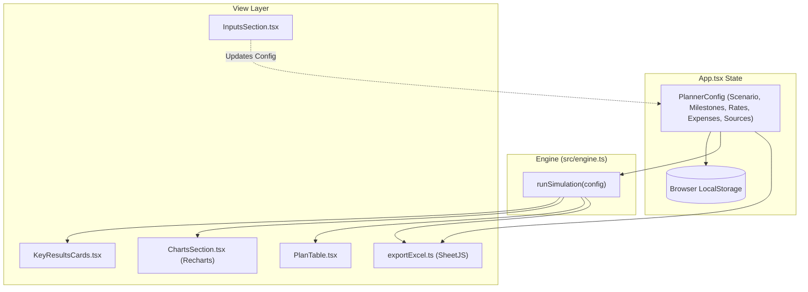

# Retirement Financial Planner — Architecture & System Wiki

Comprehensive technical and functional documentation for the **Retirement Financial Planner** web application.

---

## Table of Contents

- [1. Project Overview](#1-project-overview)
  - [1.1 Purpose & Problem Statement](#11-purpose--problem-statement)
  - [1.2 Evolution from Spreadsheet to Web Application](#12-evolution-from-spreadsheet-to-web-application)
- [2. System Architecture & Tech Stack](#2-system-architecture--tech-stack)
  - [2.1 Technology Stack](#21-technology-stack)
  - [2.2 Directory & Codebase Structure](#22-directory--codebase-structure)
  - [2.3 High-Level Component & Data Flow](#23-high-level-component--data-flow)
- [3. User Inputs & Configuration Model](#3-user-inputs--configuration-model)
  - [3.1 Scenario Parameters](#31-scenario-parameters)
  - [3.2 Milestone Ages & Phase Triggers](#32-milestone-ages--phase-triggers)
  - [3.3 Economic & Tax Rates](#33-economic--tax-rates)
  - [3.4 Monthly Expenses](#34-monthly-expenses)
  - [3.5 Income & Asset Sources (Up to 20)](#35-income--asset-sources-up-to-20)
- [4. Calculation Engine & Mathematical Logic](#4-calculation-engine--mathematical-logic)
  - [4.1 Retirement Phase Segmentation & Proration](#41-retirement-phase-segmentation--proration)
  - [4.2 Expense Inflation & Guaranteed Cash Flows](#42-expense-inflation--guaranteed-cash-flows)
  - [4.3 Gross-Up Withdrawal & Tax Projections](#43-gross-up-withdrawal--tax-projections)
  - [4.4 Priority-Based Withdrawal Cascading](#44-priority-based-withdrawal-cascading)
  - [4.5 End-of-Year Balances & Depletion Detection](#45-end-of-year-balances--depletion-detection)
- [5. User Interface & Visualizations](#5-user-interface--visualizations)
  - [5.1 Dashboard & Key Results KPI Cards](#51-dashboard--key-results-kpi-cards)
  - [5.2 Interactive Recharts Layer](#52-interactive-recharts-layer)
  - [5.3 Detailed Year-by-Year Simulation Table](#53-detailed-year-by-year-simulation-table)
  - [5.4 In-Browser Excel (.xlsx) Exporter](#54-in-browser-excel-xlsx-exporter)
- [6. Development & Operational Commands](#6-development--operational-commands)

---

## 1. Project Overview

### 1.1 Purpose & Problem Statement
The **Retirement Financial Planner** is a multi-decade financial projection and simulation application designed to answer the central retirement question:
> *"Given my current portfolio accounts, milestone ages, and spending habits, how long will my retirement funds last, and what is the optimal withdrawal sequence to minimize tax liabilities while keeping cash flows covered?"*

The system projects year-by-year cash flows across up to 40 years, accounting for:
1. **Asset Depletion vs. Guaranteed Streams**: Differentiating between depletable investment assets (401ks, IRAs, taxable brokerage, savings) and guaranteed lifetime income (Social Security, pensions, annuities).
2. **Phase-Based Transitions**: Accommodating milestone ages such as penalty-free retirement account access, Medicare eligibility, and Required Minimum Distributions (RMDs).
3. **Tax-Aware Withdrawal Gross-Ups**: Calculating required gross withdrawals to ensure that net after-tax proceeds satisfy inflation-adjusted living and healthcare expenses.
4. **Transparent Order-of-Liquidation**: Dynamically cascading withdrawals through available accounts strictly based on user-assigned priorities (lowest priority number tapped first).

### 1.2 Evolution from Spreadsheet to Web Application
The application was originally architected as a Python script (`build_planner.py`) utilizing `openpyxl` to compile an Excel workbook (`Retirement_Financial_Planner.xlsx`). 

To make the planner instantly accessible, interactive, and mobile-friendly without requiring spreadsheet software, the project was migrated to a modern client-side Single Page Application (SPA). The mathematical logic of the Excel calculation chain has been converted into a pure TypeScript simulation engine, accompanied by interactive data visualizers and a built-in Excel export utility that generates the multi-tab workbook on demand.

---

## 2. System Architecture & Tech Stack

### 2.1 Technology Stack
- **Runtime Environment**: Node.js 22 (dev/build).
- **Core Framework**: React 18+ with TypeScript in strict mode.
- **Build Tool & Bundler**: Vite 6.
- **Styling**: Tailwind CSS v4 using modern `@import "tailwindcss";` syntax.
- **Iconography**: Lucide React.
- **Data Visualization**: Recharts (SVG-based reactive line, area, and stacked bar charts).
- **Excel Generation**: SheetJS (`xlsx`) for client-side multi-sheet `.xlsx` file compilation.
- **Client Persistence**: Browser `localStorage` for automatic draft preservation.

### 2.2 Directory & Codebase Structure

```
/
├── index.html                   # HTML entry point with metadata tags
├── metadata.json                # AI Studio application manifest & permissions
├── package.json                 # Scripts (dev, build, lint) and dependencies
├── tsconfig.json                # TypeScript compilation configuration
├── vite.config.ts               # Vite configuration (port 3000, 0.0.0.0 host)
├── WIKI.md                      # System documentation & wiki
├── src/
│   ├── main.tsx                 # React application mounting point
│   ├── index.css                # Tailwind CSS global styles
│   ├── App.tsx                  # Root application component & state orchestrator
│   ├── types.ts                 # Central TypeScript interfaces & type definitions
│   ├── defaultData.ts           # Baseline scenario parameters and sample accounts
│   ├── engine.ts                # Deterministic retirement simulation engine
│   ├── exportExcel.ts           # In-browser Excel workbook generator
│   └── components/
│       ├── Header.tsx           # Top navigation, plan metadata & global actions
│       ├── KeyResultsCards.tsx  # KPI summary metrics (Depletion, Balance, Taxes)
│       ├── ChartsSection.tsx    # Responsive charts (Depletion, Income, Expenses, Balances)
│       ├── PlanTable.tsx        # Year-by-year simulation table with drawer details
│       ├── InputsSection.tsx    # Parameter forms & 20-source account manager
│       └── PhaseExplanationCard.tsx # Visual guide to milestone phases
```

### 2.3 High-Level Component & Data Flow



---

## 3. User Inputs & Configuration Model

All parameters are structured within the `PlannerConfig` interface in `src/types.ts`.

### 3.1 Scenario Parameters
| Field | Type | Default | Description |
| :--- | :--- | :--- | :--- |
| `userName` | `string` | `"John Doe"` | Plan owner's name, used in titles and exports. |
| `birthDate` | `string` (`YYYY-MM-DD`) | `"1970-06-15"` | Reference date for calculating exact age at retirement and each simulation year. |
| `retSalary` | `number` | `$150,000` | Full-year salary in the retirement year, prorated during Phase 0. |
| `retDate` | `string` (`YYYY-MM-DD`) | `"2030-07-01"` | Target date marking the start of retirement. |
| `ssStartDate` | `string` (`YYYY-MM-DD`) | `"2037-06-15"` | Target Social Security start date (informational). |
| `pensionStartDate` | `string` (`YYYY-MM-DD`) | `"2032-06-15"` | Target pension start date (informational). |
| `taxablePct` | `number` | `0.70` (70%) | Share of portfolio withdrawals sourced from taxable accounts. |
| `lifeExpAge` | `number` | `90` | Planning horizon target age for fund depletion evaluation. |

### 3.2 Milestone Ages & Phase Triggers
- `retireAcctAge` (Default: `60`): Earliest age to withdraw from 401(k) / Traditional IRA without early withdrawal penalty.
- `ssMinAge` (Default: `62`): Earliest age eligible for Social Security retirement benefits.
- `medicareAge` (Default: `65`): Transition point to Medicare health coverage.
- `rmdAge` (Default: `73`): Age triggering mandatory distributions from pre-tax retirement accounts.

### 3.3 Economic & Tax Rates
- `investRate` (Default: `6.0%`): Nominal annual compound growth applied to remaining depleting account balances.
- `inflationRate` (Default: `2.5%`): Annual escalation rate applied to base monthly living and medical expenses.
- `fedBracket` (Default: `22.0%`): Target marginal federal tax rate for taxable cash flows.
- `stateRate` (Default: `5.0%`): Flat state income tax rate.
- `capgainRate` (Default: `15.0%`): Long-term capital gains tax rate applied to investments.
- `capgainPct` (Default: `0.0%`): Proportion of taxable withdrawals treated as capital gains vs. ordinary income.

### 3.4 Monthly Expenses (Base Year)
- `expDaily` (Default: `$5,000`): General after-tax day-to-day living expenses.
- `expMedPremium` (Default: `$600`): Healthcare insurance premiums.
- `expMedOop` (Default: `$300`): Medical out-of-pocket expenses, co-pays, and prescriptions.
- **Annualized Base Outflow**: `12 * (5,000 + 600 + 300) = $70,800/year`.

### 3.5 Income & Asset Sources (Up to 20)
Each source within `sources[]` defines an account or guaranteed cash flow:
- `name`: Display label (e.g., `"401k Tax deferred"`, `"Social Security"`).
- `balance`: Initial starting balance (for depleting accounts).
- `priority`: Liquidation priority integer (1, 2, 3...); lower numbers are liquidated first.
- `monthly`: `'N'` for depleting asset pools; `'Y'` for non-depleting recurring cash flows.
- `taxType`: `'Income'` (ordinary income tax), `'Capital Gain'` (capital gains rate), or `'N/a'` (tax-free Roth or cash).
- `annualPayment`: Recurring annual payout (when `monthly === 'Y'`).
- `startAge`: Age threshold when the source becomes unlocked or starts paying out.

---

## 4. Calculation Engine & Mathematical Logic

The calculation engine (`src/engine.ts`) runs a deterministic 40-year simulation loop.

### 4.1 Retirement Phase Segmentation & Proration
For each simulation year $i \in [0, N-1]$:
$$\text{Calendar Year} = \text{retYear} + i$$
$$\text{Age} = \text{retAge} + i$$

In the retirement transition year ($i = 0$, Phase 0):
$$\text{Work Fraction} = \frac{\text{retDate} - \text{Jan 1 of retYear}}{365}$$
$$\text{Prorated Salary} = \text{retSalary} \times \text{Work Fraction}$$

For subsequent years ($i > 0$):
$$\text{Phase} = 1 + \mathbb{I}(\text{Age} \ge \text{retireAcctAge}) + \mathbb{I}(\text{Age} \ge \text{ssMinAge}) + \mathbb{I}(\text{Age} \ge \text{medicareAge}) + \mathbb{I}(\text{Age} \ge \text{rmdAge})$$

### 4.2 Expense Inflation & Guaranteed Cash Flows
Expenses escalate nominally with inflation:
$$\text{Expenses}_i = \text{Annual Expense}_{\text{base}} \times (1 + \text{inflationRate})^i$$

Guaranteed income sources ($monthly = \text{'Y'}$) contribute only when $\text{Age}_i \ge \text{startAge}$:
$$\text{Guaranteed Total}_i = \sum_{s \in \text{guaranteed}} s.\text{annualPayment}$$
$$\text{Guaranteed Taxable}_i = \sum_{s \in \text{guaranteed, taxType='Income'}} s.\text{annualPayment}$$
$$\text{Other Taxable}_i = \text{Guaranteed Taxable}_i + \text{Salary}_i$$

### 4.3 Gross-Up Withdrawal & Tax Projections
To ensure that after-tax withdrawals and guaranteed income meet the full expense requirement, the required gross withdrawal is computed using the effective tax drag:

$$\text{Combined Tax Rate } (r_{\text{inc}}) = \text{fedBracket} + \text{stateRate}$$
$$r_{\text{tax}} = \text{taxablePct} \times \left[(1 - \text{capgainPct}) \times r_{\text{inc}} + \text{capgainPct} \times \text{capgainRate}\right]$$
$$\text{Gross Withdrawal Needed } (W_i) = \max\left(0, \frac{\text{Expenses}_i - (\text{Guaranteed Total}_i + \text{Salary}_i) + r_{\text{inc}} \times \text{Other Taxable}_i}{1 - r_{\text{tax}}}\right)$$

Taxes are then partitioned into federal, state, and capital gains:
$$\text{Fed Tax} = \text{fedBracket} \times \text{Other Taxable}_i + \text{fedBracket} \times \text{taxablePct} \times (1 - \text{capgainPct}) \times W_i$$
$$\text{State Tax} = \text{stateRate} \times \text{Other Taxable}_i + \text{stateRate} \times \text{taxablePct} \times (1 - \text{capgainPct}) \times W_i$$
$$\text{CapGain Tax} = \text{capgainRate} \times \text{taxablePct} \times \text{capgainPct} \times W_i$$
$$\text{Total Tax}_i = \text{Fed Tax} + \text{State Tax} + \text{CapGain Tax}$$

### 4.4 Priority-Based Withdrawal Cascading
Accessible depleting accounts ($monthly = \text{'N'}$, $\text{Age} \ge \text{startAge}$) are sorted by their priority order key:
$$\text{OrderKey}_j = \text{priority}_j + j \times 0.0001$$

The engine determines each account's withdrawal slice without circular formula references:
$$\text{CumIncl}_j = \sum_{k \le j} \text{BeginBalance}_k$$
$$\text{CumExcl}_j = \sum_{k < j} \text{BeginBalance}_k$$
$$\text{Withdrawal}_{j,i} = \max\left(0, \min(W_i, \text{CumIncl}_j) - \min(W_i, \text{CumExcl}_j)\right)$$

### 4.5 End-of-Year Balances & Depletion Detection
Remaining funds in each depleting account compound at the investment rate:
$$\text{EndBalance}_{j,i} = \max\left(0, \text{BeginBalance}_{j,i} - \text{Withdrawal}_{j,i}\right) \times (1 + \text{investRate})$$
$$\text{Combined End Balance}_i = \sum_{j} \text{EndBalance}_{j,i}$$

If $\text{Combined End Balance}_i \le 0$ while $\text{Age}_i \le \text{lifeExpAge}$, the simulation marks the year as **DEPLETED**, recording the exact calendar year and duration.

---

## 5. User Interface & Visualizations

### 5.1 Dashboard & Key Results KPI Cards
The top dashboard summarizes the simulation results at a glance:
- **Fund Depletion**: Indicates "Not Depleted" or highlights the exact calendar year funds run out.
- **Years Funding Lasts**: Number of years before depletion.
- **Starting Portfolio**: Combined initial value across all depleting accounts.
- **Estimated Lifetime Taxes**: Sum of projected federal, state, and capital gains taxes.

### 5.2 Interactive Recharts Layer
The visualizations component (`src/components/ChartsSection.tsx`) provides four analytical views:
1. **Overall Depletion**: Area chart displaying portfolio balance trajectory over time.
2. **Income by Source**: Stacked column chart showing withdrawals per account alongside guaranteed flows.
3. **Expenses & Taxes**: Stacked bar breakdown of baseline living expenses vs. taxes.
4. **Balances by Account**: Stacked area view illustrating how individual asset accounts deplete.

### 5.3 Detailed Year-by-Year Simulation Table
The table view (`src/components/PlanTable.tsx`) provides a tabular projection matching the Excel Plan sheet:
- Displays calendar year, age, milestone phase badge, income, withdrawals, expenses, tax breakdown, and ending balance.
- Phase filtering dropdown to isolate specific milestone segments.
- Expandable rows revealing the exact beginning balance, withdrawal amount, and ending balance for every account.

### 5.4 In-Browser Excel (.xlsx) Exporter
Clicking **Export to Excel (.xlsx)** in the header runs `exportToExcel()` (`src/exportExcel.ts`), compiling three workbook sheets:
- `Inputs`: All user-configured parameters, rates, milestone ages, and accounts.
- `Plan`: Complete year-by-year cash flow and balance grid.
- `ChartData`: Formatted data series for replicating Excel charts.

---

## 6. What-If Scenario Comparison & Optimization Engine

The application features an advanced What-If optimization engine (`src/whatifEngine.ts` and `src/components/WhatIfComparisonView.tsx`) that automatically stress-tests and optimizes your portfolio withdrawal sequencing across four distinct financial goals:

### 6.1 Strategy 1: Minimize Lifetime Tax
- **Optimization Logic**: Automatically reorders account withdrawal priorities to exhaust taxable cash and brokerage accounts before tax-deferred accounts, while executing strategic pre-73 Roth conversions to fill lower tax brackets and avoid higher future marginal tax rates.
- **Key Metric Focus**: Minimizes cumulative lifetime federal, state, and capital gains taxes paid.

### 6.2 Strategy 2: Minimize Future RMD
- **Optimization Logic**: Prioritizes traditional pre-tax 401(k) / IRA withdrawals prior to age 73 and executes larger pre-73 Roth conversions to aggressively draw down pre-tax balances before Required Minimum Distributions begin.
- **Key Metric Focus**: Lowers peak future RMD tax spikes and prevents forced high-bracket distributions in later retirement years.

### 6.3 Strategy 3: Maximize Lifetime Spending
- **Optimization Logic**: Iteratively evaluates portfolio longevity against lifestyle expenditure increases (up to +50%), identifying the highest safe annual sustainable expense multiplier that avoids premature fund depletion.
- **Key Metric Focus**: Safely maximizes annual lifestyle cash flow without running out of money.

### 6.4 Strategy 4: Maximize Estate Net Worth
- **Optimization Logic**: Prioritizes drawing down taxable cash and brokerage accounts while deferring pre-tax accounts and keeping Roth accounts completely untouched (lowest priority / priority 99) to compound tax-free for legacy heirs.
- **Key Metric Focus**: Maximizes final legacy net worth at life expectancy.

---

## 7. Development & Operational Commands

All commands are executed using npm:

```bash
# Start Vite development server (accessible at http://localhost:3000)
npm run dev

# Run TypeScript type verification
npm run lint

# Compile production build to /dist
npm run build

# Preview production build locally
npm run preview
```
